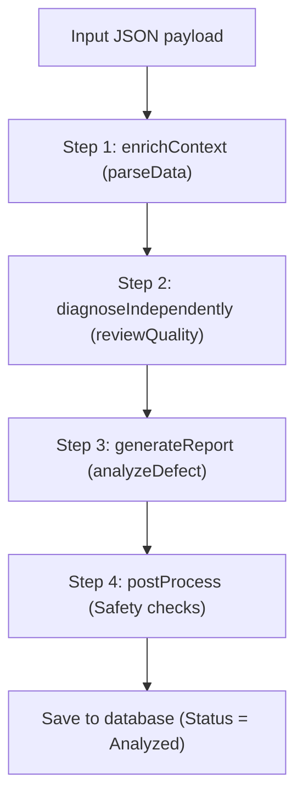

# 📘 Complete Business, AI Architecture, and End-to-End (E2E) Testing Guide - 8D Copilot

> **Competition context:** [AI4Biz 2026 - LIKELION Vietnam](https://app.notion.com/p/likelion/AI-FOR-BUSINESS-INNOVATION-3f744860a4f480ab920ddb3911a25c21), team UIT_4Lovpe. Competition requirements and submission limits are maintained in that reference; technical examples below are not measured business outcomes unless explicitly documented.

This document describes the business domain, AI processing architecture, configuration screens (`Similarity`, `Step Prompts`, and `Model Registry`), and step-by-step **end-to-end (E2E) test scenarios** for **8D Copilot (CNMA Proresolve)**.

## 📋 Contents

1. [8D Copilot Business Overview](#1-8d-copilot-business-overview)
2. [Input Data Structure (Deep Structure JSON)](#2-input-data-structure-deep-structure-json)
3. [AI Configuration Screens](#3-ai-configuration-screens)
   - [Model Registry & General Settings](#31-model-registry--general-settings)
   - [Similarity (Precedent Search)](#32-similarity-precedent-search)
   - [Step Prompts (D1-D8 Prompt Management)](#33-step-prompts-d1-d8-prompt-management)
4. [AI Processing Flow (4-Step Pipeline)](#4-ai-processing-flow-4-step-pipeline)
5. [End-to-End Test Scenarios](#5-end-to-end-test-scenarios)
6. [Troubleshooting](#6-troubleshooting)

## 1. 8D Copilot Business Overview

In manufacturing Quality Management (QM), a product incident or defect case requires Quality Engineers to investigate and prepare an **8D (8 Disciplines)** report that identifies the root cause and defines permanent corrective actions.

### 🎯 What problems does 8D Copilot address?

- **Automated extraction and analysis**: Accept incident data from the QM system and analyze measurements, equipment, and processes.
- **Independent/Blind Diagnosis**: AI identifies a root cause with **ALL ENGINEER ANSWERS REMOVED** (the 5-Why chain, Ishikawa analysis, and FMEA), then compares its conclusion with the engineer's conclusion (Same conclusion / Different conclusion).
- **Precedent Search**: Retrieve historical cases with similar defect or equipment characteristics to learn from actual solutions and reduce hallucination.
- **Draft the 8D disciplines (D1 to D8)** and prepare two separate summaries:
  - **Internal Summary**: An internal summary that includes equipment, production batch, and personnel details.
  - **Customer Summary**: A customer-facing summary for a `Q1 - Customer Complaint` case, with sensitive information removed.

## 2. Input Data Structure (Deep Structure JSON)

The input to 8D Copilot is **one Case Notification** (a QM quality-incident record in table `QMEL`) with nested components (Deep Structure):

```json
{
  "notificationId": "8D-10048651",
  "origin": "Q1 - Customer Complaint",
  "symptomShortText": "Coating peel found at customer incoming inspection",
  "status": "In Process",
  "foundDate": "2026-08-01",
  "quantityExtent": "74 units affected",
  "teamSize": 2,
  "material": {
    "materialId": "MAT-10555",
    "description": "Housing Cover C80"
  },
  "batch": {
    "batchId": "B-51890",
    "materialId": "MAT-10555"
  },
  "defect": {
    "defectCode": "DEF-0601",
    "defectText": "Coating layer peeling"
  },
  "workCenter": {
    "workCenterId": "WC-COAT-05",
    "description": "Powder Coating Line 5"
  },
  "inspections": [
    {
      "characteristic": "Coating thickness",
      "measuredValue": "38um",
      "specValue": "60-90um"
    }
  ],
  "causesIshikawa": [
    {
      "category": "Measurement",
      "description": "Gauge GA-0117 calibration expired 2026-05-30",
      "metricValue": "-22um drift",
      "isRootCause": "Y",
      "source": "Test Equipment Mgmt"
    }
  ],
  "fiveWhyChain": [
    {
      "stepNo": 1,
      "question": "Why coating peeled?",
      "answer": "Coating thickness measured 38um against 60-90um spec",
      "evidenceCitation": "QALS/QAMR"
    },
    {
      "stepNo": 2,
      "question": "Why passed inspection?",
      "answer": "Gauge GA-0117 read 22um high",
      "evidenceCitation": "GA-0117 calibration record"
    },
    {
      "stepNo": 3,
      "question": "Why drifting gauge in service? (root cause)",
      "answer": "Calibration expired on 2026-05-30 and no interlock stopped its use",
      "evidenceCitation": "Test equipment register"
    }
  ],
  "actions": [
    {
      "lineNo": 1,
      "actionType": "Containment",
      "actionText": "Quarantine affected stock",
      "status": "Done"
    }
  ],
  "teamAssignments": [
    {
      "partnerId": "BP-100014",
      "partnerName": "Thien Tu",
      "functionTitle": "Quality Engineer",
      "partnerRole": "8D Team Leader"
    }
  ],
  "costCopq": {
    "costOfPoorQualityEur": 8600
  }
}
```

## 3. AI Configuration Screens

The system provides an **AI Settings** administration page at `/#/ai-settings` with four main tabs:

1. General Settings
2. Model Registry
3. Similarity
4. Step Prompts

### 3.1 Model Registry & General Settings

- **Model Registry**: Manage the catalog of supported foundation models and enable or disable each model.
- **General Settings**: Assign a separate model to each activity:
  - `parseData`: Select the model for reading and structuring data, for example `gemini-2.5-flash`.
  - `analyzeDefect`: Select the model for 8D reasoning and report writing, for example `gemini-2.5-pro`.
  - `reviewQuality`: Select the model for independent blind diagnosis.
  - `ThinkingBudget`: Configure the reasoning-token budget (Extended Thinking).

### 3.2 Similarity (Precedent Search)

- **Purpose**: Configure the algorithm and weights used to retrieve similar historical cases. Administrators adjust weights directly in the UI **without changing code or redeploying the server**.
- **Criteria table (`SimilarityCriteria`)**:
  - `workCenter` (+4 points): Match the workstation or production line.
  - `defectCode` (+4 points, with a keyword-match fallback of +2): Match the defect code.
  - `material` (+3 points, with a material-family fallback of +1): Match the material ID.
  - `semantic` (+3 points): Score vector similarity (Cosine Similarity) between defect descriptions with a threshold of `minSimilarity >= 0.70`.
- **Threshold configuration (`RetrievalSettings`)**:
  - `minScore` (default: at least 3 points): A historical case with a total score below 3 is excluded as a precedent to avoid irrelevant recommendations.
  - `topN` (default: `3`): Retrieve at most N of the most similar precedent cases.
  - `closedOnly` (`true`): Select only cases with `Completed` or `Closed` status.

### 3.3 Step Prompts (D1-D8 Prompt Management)

- **Purpose**: Allow administrators to customize `systemPrompt` and `userTemplate` for each step from **D1 through D8** directly in the UI.
- **Fallback**: When a configuration is disabled (`enabled = false`) or blank, the system automatically uses the standard default prompt in code (`srv/src/domain/eightd/prompts.ts`).

## 4. AI Processing Flow (4-Step Pipeline)

When a user submits case JSON (`analyzeFromJson`), the backend processes it in four steps:



1. **Step 1: enrichContext (`parseData`)**: Extract data, calculate metrics, and identify data gaps (`gaps`).
2. **Step 2: diagnoseIndependently (`reviewQuality`)**: Perform blind diagnosis. Remove the engineer's answers and let AI independently reason through a 5-Why chain and select an Ishikawa branch.
3. **Step 3: generateReport (`analyzeDefect`)**: Combine the data, blind-diagnosis result, and precedent cases to draft D1-D8, the Internal Summary, and the Customer Summary.
4. **Step 4: postProcess (Safety checks)**: Recheck constraints, repair JSON formatting, and verify source citations.

## 5. End-to-End Test Scenarios

### 🚀 Step 1: Start the system

1. Open a terminal in the `8d-copilot` project directory.
2. Start the full stack:
   ```bash
   npm run dev:all
   ```
   - **Backend**: `http://localhost:4008`
   - **Frontend UI**: `http://localhost:5544`

### ⚙️ Step 2: Test AI Settings configuration

1. Open `http://localhost:5544/#/ai-settings` in a browser.
2. **Test the Model Registry tab**:
   - Click **Sync Models**.
   - Confirm that the model list from AI Core loads successfully.
3. **Test the General Settings tab**:
   - Assign `parseData` to `gemini-2.5-flash`.
   - Assign `analyzeDefect` to `gemini-2.5-pro`.
   - Click **Save configuration** and check for the message *"AI configuration saved"*.

### 🔍 Step 3: Test Similarity & Step Prompts

1. **Test the Similarity tab**:
   - Set `minScore` to `3` and `topN` to `3`.
   - Change the *Work Center* weight from `4` to `5`.
   - Click **Save criteria**.
2. **Test the Step Prompts tab**:
   - Select **D4 (Root Cause)**.
   - Add this instruction to the *System Prompt*: `Always check equipment calibration date.`
   - Click **Save Step Prompts**.

### 📄 Step 4: Test 8D case analysis from JSON

1. Open **8D Reports** at `http://localhost:5544/#/8d`.
2. Click **Analyze from JSON** (✨ icon).
3. Copy the entire sample Deep Structure JSON file ([case-8D-10048651.json](../mock-data/clean/case-8D-10048651.json)) and paste it into the input field.
4. Click **Start Analysis**.

### 📊 Step 5: Inspect the report details

1. The browser navigates to Report Detail (`http://localhost:5544/#/8d/<ID>`).
2. Initial status: `Analyzing` (a notification with a blue background).
3. The documented example expects the page to update automatically to `Analyzed` after approximately 30-60 seconds; record the actual duration during the test.
4. **Inspect the displayed sections**:
   - ✅ **Reasoning Panel (Independent Diagnosis)**: Check that AI selects the root-cause branch (`Measurement`) and compare it with the engineer's conclusion (`Same conclusion`).
   - ✅ **Internal Summary & Customer Summary**: Check the summaries for the `Q1` case.
   - ✅ **Eight Disciplines (D1 to D8)**: Check whether D4 follows the prompt instruction just changed.
   - ✅ **AI Models Used (Footer)**: Check that the execution trace shows the assigned models:
     - `Parse: gemini-2.5-flash`
     - `Analyze: gemini-2.5-pro`
     - Token count and execution duration in seconds.

## 6. Troubleshooting

| Symptom | Cause | Resolution |
| - | - | - |
| **`SQLITE_ERROR: no such table`** | The `db.sqlite` schema has not been initialized | Run `npm run deploy:sqlite` |
| **AI API call reports `timeout of 30000ms exceeded`** | The Axios client has a 30-second timeout | The documented fix sets `timeout: 0` in `axios-instance.ts` |
| **Cannot select a model in AI Settings** | **Sync Models** has not run, or AI Core credentials are missing | Check `.env` for `AICORE_*` credentials and click **Sync** |
| **The UI does not open on port 5544** | `vite.config.ts` was overwritten | Check `server.port = 5544` in `vite.config.ts` |

*Prepared for **8D Copilot (CNMA Proresolve)**.*

# Flexible Configuration Verification

1. In AI Settings, add a D2 Form Editor field with key `problemStatement`, a visible group, and a required constraint.
2. Save the D2 configuration. Invalid or conflicting paths must be rejected immediately.
3. Run **Analyze new case** and open the completed report.
4. Confirm D2 renders `problemStatement` from `resultJson` using the saved group and widget.
5. Inspect the discipline OData data and verify `formSchemaJson`, `validationJson`, and `configVersion` are populated.
6. Change the D2 layout and run a second report. The first report must retain the old snapshot while the second uses the new layout.
7. Open an older report without snapshots and confirm the legacy `DisciplineCard` still renders.
