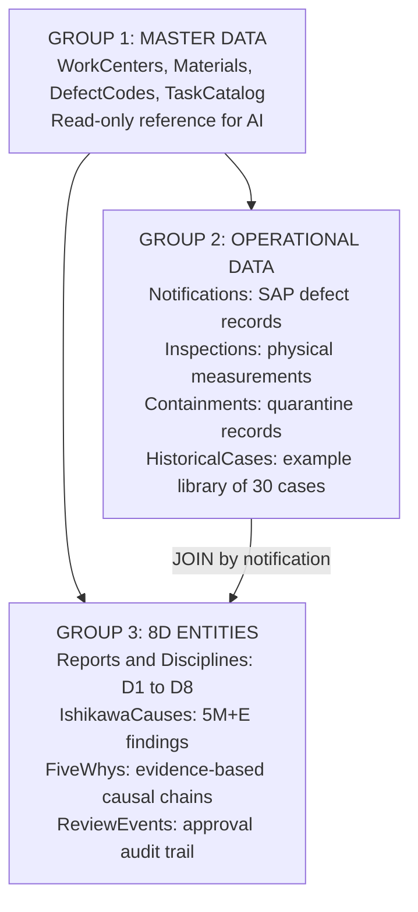
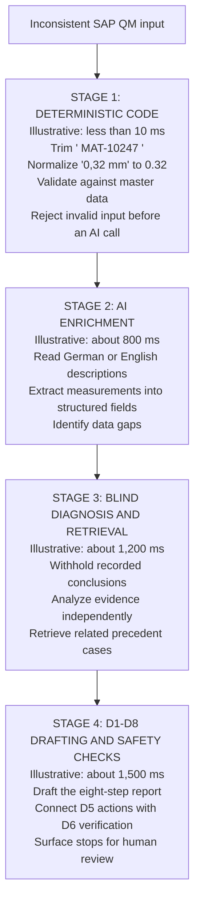

# Understanding 8D Copilot: AI Logic and Database Architecture

> **Competition context:** [AI4Biz 2026 - LIKELION Vietnam](https://app.notion.com/p/likelion/AI-FOR-BUSINESS-INNOVATION-3f744860a4f480ab920ddb3911a25c21), team UIT_4Lovpe. Competition requirements and submission limits are maintained in that reference; technical examples below are not measured business outcomes unless explicitly documented.
> **For UIT_4Lovpe team members.** This guide uses conversational technical language to explain why the system is designed this way and to help the team present it clearly to the judges.
> **Evidence boundary:** Example measurements, similarity percentages, latency estimates, and workload ratios below illustrate the explanation. They are not verified performance results or guarantees of correctness, legal compliance, or production readiness.

## 0. Explaining the project in one answer

If the judges ask, *"What is your system, exactly? Is it just ChatGPT attached to a report form?"*, a useful spoken answer is:

> "8D Copilot is an **engineering assistant and quality reviewer**. It uses physical measurements and specification limits as evidence, retrieves relevant cases through **entity relationships**, and leaves approval to an accountable human. Its purpose is to help engineers investigate and document a quality issue without treating the AI's draft as an authorized decision."

The three points to emphasize are:

1. Analysis is grounded in **measured physical deviations**, rather than unsupported assumptions.
2. Precedent retrieval uses **entity relationships (GraphAI)** as well as the configured retrieval signals, rather than relying solely on similar wording.
3. AI does **not automatically approve** an 8D step on a person's behalf. The organization's authorized reviewer retains responsibility for approval.

## 1. Database design - why separate the data into tables?

### 1.1. The shop-floor problem

When a defect occurs, such as a burr or scratch on a workpiece, incoming SAP QM records can contain inconsistent data:

- A German engineer may enter a decimal comma: `0,32 mm`, which a parser expecting a decimal point may mishandle.
- A material code may contain extra whitespace: `"  MAT-10247 "`.
- A symptom description may be abbreviated or multilingual: *"Grat an Flanschkante"* means *"burr on the flange edge"*.

Passing those records directly to an unconstrained text generator risks fabricated machine identifiers or materials that do not exist in the plant. Normalization and catalogue validation establish a reliable input boundary.

### 1.2. Three groups of data

The original explanation grouped a 16-table dataset into three categories. That count describes the example dataset, not a fixed limit on the current schema:



In plain terms:

1. **Master data provides the allowed vocabulary.** `WorkCenters`, `Materials`, and `DefectCatalogues` define actual machines, materials, and defect codes. AI may suggest an action, but an identifier such as `MILL-999` must not be accepted if it is absent from the relevant catalogue.
2. **Operational data records what happened.** `Notifications` identify the incident, `Inspections` contain measurements such as burr thickness in millimeters, and `Containments` record how much affected stock was isolated. These records connect through `notification_id`, corresponding conceptually to the SAP QMEL notification.
3. **8D entities record the investigation and review.** They track the D1 team, Ishikawa branches, 5-Why analysis, and the reviewer for each step through `ReviewEvents`. Approval, requests for changes, and reopening events belong in the audit trail. This is a traceability requirement, not a claim that arbitrary database deletion is technically impossible.

### 1.3. Why use SQLite locally?

- **In-process execution:** SQLite avoids a separate database network round trip. This supports a lightweight local development and acceptance-test setup. The original examples of four test cases completing in seconds and retrieval taking under 180 ms were illustrative timing claims, not measurements established here.
- **Lower infrastructure overhead:** Local data processing can run on an industrial computer without a cloud database. Fully offline AI also requires a compatible local model and provider configuration; SQLite alone does not make remote model calls work offline.
- **Simpler evaluation setup:** A local setup avoids requiring judges to provision Docker or a separate database password. Use the repository's documented installation and startup prerequisites; `npm start` is the example launch command, not a promise that a fresh clone needs no setup.

## 2. AI analysis - turning input data into a result

### 2.1. How the system constrains unsupported output

A judge may ask, *"How do you prevent the AI from guessing or inventing facts?"* The explanation has two main parts.

#### Constraint 1: Bounded JSON Schema

An ordinary request such as *"Write an incident report for me"* can produce unrestricted prose. The structured pipeline instead requires a predefined JSON shape:

- `measuredValue` has the required numeric type.
- `category` is limited to the six fishbone categories: `Man`, `Machine`, `Material`, `Method`, `Measurement`, and `Environment`.
- `isRootCause` uses the allowed values `'Y'` and `'N'`.

Invalid types or missing required fields trigger validation and the configured repair/retry behavior. Schema validation controls structure; it does not by itself establish that a claim is factually correct.

#### Constraint 2: First-principles analysis

The working rule is: **Check physical deviations against specifications and connect conclusions to evidence.**

For example, an engineer might write, *"The machine is operating normally; the operator is probably responsible."* The investigation should examine `Inspections` and `Telemetry` rather than accept that conclusion:

- Maximum burr height in the drawing: `0.10 mm`.
- Actual caliper measurement: `0.26 mm`.
- Clamping pressure: down from `12 bar` to `9.5 bar`.

The deviations are `+0.16 mm` and `-2.5 bar`. They support investigating tool wear and loss of clamping pressure in the **Machine** category. They do not, on their own, prove either mechanism; the engineering investigation must confirm causality.

### 2.2. Four conceptual execution stages

The workflow can be explained as four stages. The timings retained below are **illustrative assumptions from the original presentation**, not measured service-level objectives:



**Why separate these responsibilities instead of using one giant prompt?** A monolithic call can be slow, harder to diagnose, and vulnerable to request timeouts. Smaller stages make normalization, evidence handling, and recovery easier to inspect and allow useful results to appear earlier when the orchestration supports it. Splitting stages does not inherently reduce total execution time: the original comparison of 60-90 seconds for one call versus roughly 4 seconds overall was an illustrative assumption. Hosting timeout behavior, including HTTP 504 errors on platforms such as Render or Vercel, depends on the actual deployment and request limits.

## 3. GraphAI and the limits of text-only retrieval

### 3.1. Where conventional vector retrieval can fail

Vector retrieval converts text into numerical embeddings and compares their semantic similarity. Similar wording does not necessarily indicate the same physical failure mechanism.

Consider two illustrative cases:

- *"CNC milling machine MILL-07 leaves scratches on an aluminum-alloy component."*
- *"CNC lathe LATHE-03 leaves scratches on a round steel component."*

Both mention scratches, a CNC machine, and a component. An embedding might rank them as similar; **92%** in the original example is a hypothetical score. Reusing a lathe grooving-tool adjustment for a milling process with a worn end mill could be inappropriate. A wrong corrective action may damage a tool or scrap a batch, with the actual loss depending on the plant and product. Semantic similarity is useful evidence, not engineering authorization.

### 3.2. Using entity relationships

Graph retrieval examines an **entity knowledge graph**. The following example shows the relationship dimensions that can justify investigating a precedent; it is not a measured result or a claim that every configured graph query uses all three links:

| Relationship between precedent `8D-10048412` and the current case | Example evidence |
| - | - |
| Same work center | Milling work center `WC-MILL-07`. |
| Related material or material family | Cast aluminum material `MAT-10247`. |
| Same defect code, where that signal is available | Edge burr `DF-BURR-01`. |
| Successful action in the precedent | Replace the deburring tool and recalibrate the fixture. |
| Candidate action for engineering review | Inspect or replace deburring tool `EQ-MILL07-002` and check clamping pressure. |

Think of this as looking up the equipment's connected history. Five concepts used in the explanation are:

1. `sameWorkCenter`: Has this work center experienced a similar issue, such as recurring mechanical fatigue?
2. `sameMaterialFamily`: Do related alloys have relevant cutting-stress characteristics?
3. `sameDefectCode`: Is there a match in the plant's technical defect catalogue? A catalogue code should not be assumed to be an ISO/VDA standard code merely because it is stored in QM.
4. `resolvedByActionType`: Which action types were associated with successful resolution, such as replacing a tool, reworking a fixture, or changing stock?
5. `GraphAnchor`: The starting context for retrieving related cases without an unnecessary full traversal. It is an anchor concept, not itself a relationship edge.

These are explanatory concepts; the actual probes and available edges are defined by the graph implementation and dataset. In particular, the documented 25-case graph dataset has unique defect codes, so a shared-code path is not a useful connection between those historical cases.

### 3.3. Two-stage retrieval and caching

- **Stage 1:** The selected engine gathers and scores candidates. The scoring engine can combine rules, such as work-center, defect-code, and material matches, with cosine similarity. Example weights of `+4`, `+4`, and `+3` illustrate this scoring. The graph engine instead uses its step-specific relationship evidence. A top-10 pool is an example; the actual pool is bounded by the configured retrieval logic.
- **Stage 2:** When enabled for D4 or D5, AI reads the candidate pool with the current case and scores physical-mechanism relevance or corrective-action fit. The original 15 ms stage-1 and 150 ms stage-2 figures are illustrative assumptions. The live-model observations in the graph retrieval guide are much slower, and the reranker has a 45-second default timeout.
- **SHA-256 and LRU cache:** The reranker hashes its prompt/frame, query text, and candidate content. Matching requests can reuse normalized verdicts without another model call. The cache has a 15-minute TTL and a 256-entry bound, and concurrent identical calls are deduplicated. Switching D steps does not guarantee a hit because the frame or candidate content may differ. A sub-10-ms cache response is an illustrative expectation, not a measured guarantee.

## 4. AI Referee and blind diagnosis

### 4.1. Confirmation bias under production pressure

When scrap appears under shipment pressure, an investigation may prematurely blame an operator under the Ishikawa **Man** category: *"The shift C operator was careless"*, *"the setup was incorrect"*, or *"the work instruction was not read carefully"*.

If the real mechanism is spindle play, disciplining a worker will not prevent recurrence. This is an illustrative failure pattern, not a claim that engineers or factories always behave this way.

### 4.2. How blind diagnosis challenges the recorded conclusion

Example input:

```text
Engineer's incident record
  Note: "The shift C operator misaligned the fixture."
  Ishikawa: Man (isRootCause = 'Y')
  Inspection: tool-head play 0.9 mm; allowed maximum 0.2 mm
  History: the defect appears on shifts A, B, and C
```

The review proceeds in three stages:

1. **Build blind evidence (`blindEvidence.ts`).** Remove the recorded root-cause answer, `isRootCause` flags, 5-Why answers, corrective and preventive actions, FMEA conclusions, and lessons learned that reveal the answer. Retain inspections, header/product context, Is/Is-Not evidence, containment actions, and factual Ishikawa investigation findings without the root-cause flag. The implementation does not simply delete every Ishikawa finding.
2. **Analyze the evidence independently.** Tool-head play of `0.9 mm` exceeds the `0.2 mm` limit. Occurrence across shifts A, B, and C weakens an explanation specific to one operator. Together these facts support a **Machine** hypothesis for further investigation; they do not categorically exclude every human factor.
3. **Compare and request adjudication.** Contrast the recorded **Man** conclusion, which lacks a supporting measurement in this example, with the evidence-backed **Machine** hypothesis. A `record-contradicts-evidence` reason under `unverified-facts` can block D4 and ask the **Quality Engineer** to confirm which conclusion the evidence supports. The code does not itself establish an automatic referral to a quality board or prove that the AI's diagnosis is correct.

The practical analogy is a video-assisted referee: evidence is reviewed independently before a decision is accepted. The goal is to challenge unsupported blame and focus the investigation on the physical problem while retaining human accountability.

## 5. AI stops and human approval

### 5.1. Recognizing when a decision lacks support

The implementation in `stops.ts` defines **three stop types**: `unverified-facts`, `outside-scope`, and `exceeds-authority`. The four examples below describe common scenarios, not four independent type identifiers:

| Scenario | Trigger | Response |
| - | - | - |
| **Unverified measurements** (`unverified-facts`) | No measured number is available, or a number was extracted from ambiguous free text and has not been confirmed. | Block D4 and ask the Quality Engineer to confirm the characteristic, measurement, unit, and specification. |
| **Recorded conclusion contradicts evidence** (`record-contradicts-evidence`, under `unverified-facts`) | The recorded root cause differs from the independent finding, or an unsupported category is flagged while another has a measured deviation. | Block D4 and request an evidence-based review of the root cause. |
| **Authority exceeded** (`exceeds-authority`) | COPQ is **at least EUR 10,000**, the configured sign-off threshold. | Block D8 pending Quality Manager review and agreement to close. This does not establish that a cryptographic digital-signature feature exists. |
| **No qualifying precedent** (`outside-scope`) | The library has no qualifying case, for example a laser-welding issue in a library focused on milling. The 30-case library is an illustrative dataset size. | Do not cite or adapt a nonexistent precedent. Ask for a subject-matter expert and the first checks to perform. This reason is **non-blocking**: an engineer can still decide D4 from the current case's own evidence. |

Other authority checks include customer notification at D8, lot disposition at D3, and controlled-document changes at D7. Their required roles and blocking behavior come from the stop configuration. A request for expert help should identify the missing evidence; it is not necessarily a fixed package of three questions.

### 5.2. Why approval remains human

The architecture reserves approval for authorized people instead of treating an AI-generated draft as approval. This is a design choice for accountable quality management, not a measured automation percentage.

In automotive manufacturing, an escaped defect can have serious safety consequences and lead to costly recalls. An investigation must be able to identify who authorized release and on what evidence. AI can assist with drafting, calculations, and independent review; it cannot replace the organization's accountable sign-off process.

The original **80% AI work / 20% human decision** description is a communication analogy, not a measured workload split or a provision quoted from IATF 16949 / VDA 6.3. The organization's actual approval roles and legal obligations depend on its applicable procedures and requirements.

## 6. StepGraph dependencies and workflow governance

Engineers must connect corrective actions to an investigated cause and verify their effectiveness before closure. The implementation distinguishes **generation dependencies** from **human approval gates**.

`stepGraph.ts` defines the generation dependency graph:

| Generated step | Required preceding context |
| - | - |
| D1 | None. |
| D2 | None. |
| D3 | D2. |
| D4 | D2. |
| D5 | D3 and D4. |
| D6 | D4 and D5. |
| D7 | D4 and D5. |
| D8 | D5, D6, and D7. |

D1 establishes the team and D2 defines the problem, including what is and is not affected. D3 containment and D4 diagnosis can be generated after D2; **the graph does not require D3 approval before generating D4**. D5 needs both containment and root-cause context. D6 and D7 depend on the cause and correction, while D8 summarizes correction, verification, and prevention.

Operationally, containment still needs prompt attention so defective products do not continue downstream while the investigation proceeds. Human approval and evidence gates govern acceptance separately from the order in which AI drafts content. For review, **`ChangeRequested`** expresses that the case needs more work; an unresolved quality issue should not simply be discarded as a terminal `Rejected` record.

## 7. Suggested spoken presentation

Use the following outline to explain the design in your own words. Presentation durations are approximate speaking allocations, not project schedules.

### Part 1: Opening, approximately 30 seconds

> "Members of the judging panel, AI in a factory is often presented as a chatbot that writes reports. But polished writing does not remove scrap. UIT_4Lovpe presents **8D Copilot**, a quality investigation assistant built around SAP QM concepts, physical measurements, and precedent retrieval through connected entities. It helps engineers assemble evidence, review a proposed cause, and document the eight disciplines."

### Part 2: Three technical points, approximately two minutes

> "First, **structured output and evidence checks** constrain the draft. Machine and component identifiers are checked against master data. JSON Schema controls the output structure, while physical measurements support or challenge the diagnosis. A tool-wear hypothesis should be connected to evidence such as an out-of-spec burr measurement and then verified.
>
> Second, **relationship-based retrieval** adds engineering context to text similarity. A scratch on a turned steel part and a scratch on a milled aluminum part may look similar in text while requiring different corrections. We use work centers, material families, available defect-code relationships, action history, and other graph evidence to explain why a precedent is relevant. Optional D4/D5 reranking examines the mechanism or action fit.
>
> Third, **AI Referee challenges unsupported conclusions**. Blind diagnosis withholds the recorded root-cause answer and exposes the underlying evidence. If an operator is blamed without support while a measurement shows 0.9 mm of mechanical play, the system can flag that contradiction and require a quality engineer to review it. The AI's role is to expose the conflict, not to become the final authority."

### Part 3: Closing, approximately 30 seconds

> "Approval remains with the authorized reviewer. The assistant performs drafting and analysis, but acceptance of a correction and closure of an 8D case remain accountable human decisions. **8D Copilot connects evidence, precedent, and review** so engineers can spend less effort assembling records and more effort resolving the actual problem. Any time-saving claim must be measured in a representative deployment. Thank you."

The original 90% paperwork-saving claim and immediate large-scale production-readiness claim are not established by this document and should not be presented as measured outcomes.

## 8. Five judge questions and suggested answers

### Q1. Why add a graph instead of using vector retrieval alone?

> "Vector retrieval is useful for semantic similarity, but two descriptions can share words while referring to different processes or mechanisms. For example, scratches from turning and milling may require different actions. Graph relationships add work-center, material, action, and other recorded context to justify a match. The graph improves traceability; it does not guarantee perfect engineering accuracy."

The original example of 90% text similarity is hypothetical. Actual ranking quality requires a representative retrieval evaluation.

### Q2. How can you be certain that the AI never fabricates data?

> "We do not claim a 100% guarantee. We use three complementary controls: **JSON Schema** for required types and enums; **evidence-based analysis** that ties causal claims to measurements and flags missing support; and **catalogue validation** that checks generated identifiers against master data. These checks reduce specific failure modes, and an authorized engineer still reviews the result."

### Q3. Can this run offline in a factory, or must it call OpenAI or DeepSeek over the internet?

> "The local database and deterministic normalization can run without a cloud database. The example dataset uses SQLite in-process. Fully offline AI additionally requires a compatible local model and provider. A composite `LlmProvider` design can route to a local service such as Ollama or LM Studio where that integration is configured and validated. A cloud AI endpoint still requires connectivity, so offline operation must be demonstrated for the actual deployment."

### Q4. How does blind diagnosis work in practice?

> "`blindEvidence.ts` constructs a restricted evidence object. It removes recorded root-cause answers, answer flags, 5-Why conclusions, and other fields that reveal the expected answer. It keeps raw inspections, relevant context, and factual investigation findings. The AI produces an independent analysis before that result is compared with the recorded diagnosis. If the record blames a person without evidence while measurements point toward equipment, the system can raise a D4 stop asking the Quality Engineer to resolve the contradiction."

### Q5. Why not let AI approve every step for complete automation?

> "Approving a corrective action or closing an 8D case is an accountable quality decision. Our design gives AI the drafting, calculation, and review support roles while authorized people retain approval. This makes the evidence and responsible reviewer explicit. The 80/20 split sometimes used to explain that division is an analogy, not a measured automation rate."

*Internal technical reference - UIT_4Lovpe - AI4Biz 2026 - LIKELION Vietnam.*
