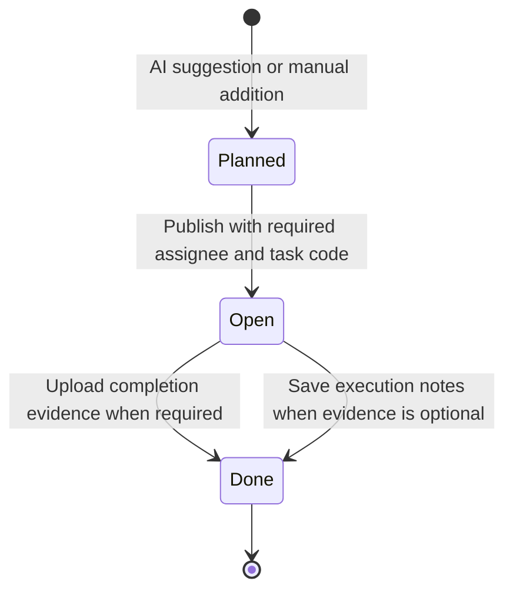
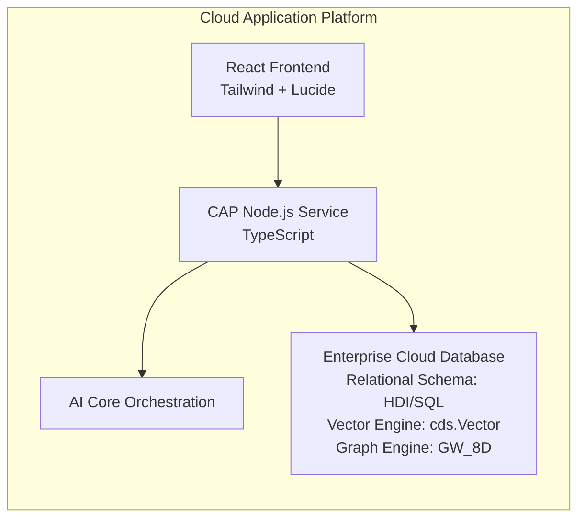
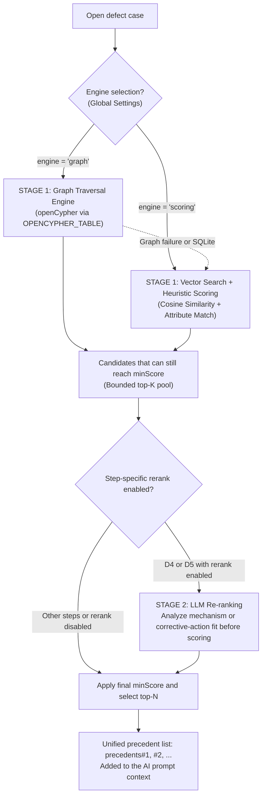

# 8D Business Processes and AI Infrastructure

> **Competition context:** [AI4Biz 2026 - LIKELION Vietnam](https://app.notion.com/p/likelion/AI-FOR-BUSINESS-INNOVATION-3f744860a4f480ab920ddb3911a25c21), team UIT_4Lovpe. Competition requirements and submission limits are maintained in that reference; technical examples below are not measured business outcomes unless explicitly documented.

**Project:** 8D Copilot (CNMA Proresolve)
**Environment:** Enterprise Cloud Platform
**Audience:** Hackathon team members, software engineers, and business analysts
**Core principle:** The implementation is the source of truth.

## Contents

- [System overview and business value chain](#system-overview-and-business-value-chain)
- [Part 1: Business value and the 8D workflow](#part-1-business-value-and-the-8d-workflow)
  - [D1: Establish the Team](#d1-establish-the-team)
  - [D2: Describe the Problem and the Is / Is-Not Matrix](#d2-describe-the-problem-and-the-is--is-not-matrix)
  - [D3: Interim Containment Actions](#d3-interim-containment-actions)
  - [D4: Root Cause Analysis and Blind Diagnosis](#d4-root-cause-analysis-and-blind-diagnosis)
  - [D5: Permanent Corrective Actions](#d5-permanent-corrective-actions)
  - [D6: Validate Effectiveness](#d6-validate-effectiveness)
  - [D7: Preventive Actions and FMEA Updates](#d7-preventive-actions-and-fmea-updates)
  - [D8: Team Recognition and Case Closure](#d8-team-recognition-and-case-closure)
- [Part 2: AI and data architecture](#part-2-ai-and-data-architecture)
  - [1. Platform and environment configuration](#1-platform-and-environment-configuration)
  - [2. Model tiers and AI Core orchestration](#2-model-tiers-and-ai-core-orchestration)
  - [3. Two-stage precedent retrieval](#3-two-stage-precedent-retrieval)
  - [4. Code architecture map](#4-code-architecture-map)

## System overview and business value chain

In automotive manufacturing, including VDA 6.3 / IATF 16949 contexts, and enterprise Quality Management (QM), **8D (Eight Disciplines)** provides a structured problem-solving method. The system's central principle is that **AI acts as a data-grounded copilot while people retain decision authority**. The enterprise ERP/QM records provide the factual basis for its suggestions.

The business value chain is structured as follows:

```mermaid
flowchart LR
    A["1. Inspection Result<br/>(QALS inspection lot)"] --> B["2. Defect Recorded<br/>(QM defect code recorded)"]
    B --> C["3. 8D Opened<br/>(Decision to initiate an 8D case)"]
    C --> D["4. Precedents Retrieved<br/>(Knowledge Graph / Rerank)"]
    D --> E["5. D1 - D8 Drafted<br/>(AI Copilot suggestions)"]
    E --> F["6. Human Review & Governance<br/>(State Machine / Evidence)"]
    F --> G["7. Case Closed<br/>(Added to the precedent library)"]

    style D fill:#fef3c7,stroke:#d97706,stroke-width:2px;
    style E fill:#dbeafe,stroke:#2563eb,stroke-width:2px;
    style F fill:#dcfce7,stroke:#16a34a,stroke-width:2px;
```

> [!IMPORTANT]
> **Recording a defect in step 2 and opening an 8D case in step 3 are separate actions.**
> Most shop-floor defects can be handled locally without an 8D case. For a serious or recurring defect, or one arising from a customer complaint, a user can initiate an 8D case from the Master Data or Defect Record screen.

## Part 1: Business value and the 8D workflow

### D1: Establish the Team

#### 1. Business meaning and quality requirements

- Complex quality problems require a **cross-functional team** with knowledge of the product, process, and quality system at the affected station.
- **Inputs:** Current defect information, including the defect code, work center `workCenterId`, material family `materialFamily`, and product `materialId`.

#### 2. System behavior and data lifecycle

- The system distinguishes two structures:
  - `team.roster`: The team proposed by AI.
  - `team.assignedRoster`: The official team approved by an engineer or quality manager through `Save Team Assignment`.
- The team follows the QM role structure:
  - **Team Leader:** Responsible for coordination.
  - **Champion / Sponsor:** Management representative who provides resources and support.
  - **Members:** Process engineers, operating technicians, and QA/QC representatives.
- Validation requires selected people to exist in the partner personnel directory (`ValueHelpService` / Partner Directory) and have expertise relevant to the `WorkCenter`.

#### 3. AI processing and data constraints

- **Precedent retrieval:** When graph retrieval is selected, the algorithm retrieves historical cases sharing `workCenter` and `materialFamily` evidence.
- **Prompt and analysis behavior:**
  - If the current record already contains personnel assignments, AI preserves those system facts (`x-source: qm_system`).
  - Otherwise, AI examines teams in precedent cases (`precedents#N`), identifies actual roles such as Leader, Member, and Specialist, and proposes real people who handled similar defects successfully.
  - **Negative constraint:** AI must not invent job titles or names absent from the database. It must cite sources such as `sources: ["team.leader", "precedents#1.team"]`.
- **Post-processing (`postProcess.ts`):** Validates citations and sets `dataBacked = false` when no matching evidence exists in QM data or a precedent case.

#### 4. Code references

- **Prompt and schema:** [prompts.ts](../srv/src/domain/eightd/prompts.ts), `DEFAULT_DISCIPLINE_GUIDE.D1`, and [schemas.ts](../srv/src/domain/eightd/schemas.ts).
- **Frontend widget:** [team-roster-widget.tsx](../app/8D_hackathon_ui/src/pages/eight-d/team-roster-widget.tsx).
- **Partner value help:** [ValueHelpService.cds](../srv/ValueHelpService.cds).

### D2: Describe the Problem and the Is / Is-Not Matrix

#### 1. Business meaning and quality requirements

- The Kepner-Tregoe approach describes the problem through contrast: **what is affected (IS), and what could reasonably have been affected but is not (IS-NOT)**.
- **Inputs:** 5W2H defect information (What, When, Where, Who, Why, How, How Many) and historical inspection-lot records (`QALS`/`QAMR`).

#### 2. System behavior and data lifecycle

- **Deterministic Is / Is-Not matrix:** The system calculates this comparison from inspection records rather than asking an LLM to invent it. [isIsNot.ts](../srv/src/domain/eightd/isIsNot.ts) performs the statistical calculation:
  - Group inspection lots by equipment or fixture (`equipment`).
  - Calculate each group's non-conforming rate, requiring at least $2$ lots per group.
  - Compare the highest-defect-rate group (IS) with the lowest-defect-rate group (IS-NOT).
  - If the contrast is $\ge 25\%$, identify the comparison as significant technical evidence. If contrast or measurements are insufficient, explicitly explain why the comparison is not applicable (`applicable: false`).

#### 3. AI processing and data constraints

- **5W2H description:** AI extracts technical values, including `measuredValue`, specification limit `specValue`, unit `specUom`, and out-of-spec status `outOfSpec`.
- **Using the Is / Is-Not result:** AI receives the objective calculation from `isIsNot.ts` and populates the form without changing plant measurements.
- **Q1 versus Q3 context:**
  - For `Q1 - Customer Complaint`, AI adds a polite `customerSummary` without internal blame.
  - For `Q3 - Internal Defect`, `customerSummary` is `null`.

#### 4. Code references

- **Is / Is-Not algorithm:** [isIsNot.ts](../srv/src/domain/eightd/isIsNot.ts).
- **Frontend display:** [problem-widgets.tsx](../app/8D_hackathon_ui/src/pages/eight-d/problem-widgets.tsx).
- **Post-processing:** [postProcess.ts](../srv/src/domain/eightd/postProcess.ts), `reconcileD2IsIsNot`.

### D3: Interim Containment Actions

#### 1. Business meaning and quality requirements

- Interim Containment Actions (ICA) aim to **isolate defective products immediately and protect customers and downstream operations** while the root cause is still being investigated.
- Examples include stopping a shipment, quarantining stock, adding a second full inspection pass (often called 200% inspection), or installing a temporary blocking fixture. Complete protection is the objective, not an automatically demonstrated outcome.

#### 2. System behavior and task lifecycle

The execution table in [action-table.tsx](../app/8D_hackathon_ui/src/pages/eight-d/action-table.tsx) follows a controlled state machine:

The state-transition rules are:

1. **Planned $\rightarrow$ Open:** Users cannot choose the state directly from a dropdown. The task becomes `Open` when an engineer selects **Publish**. It requires an `assignee`, `durationDays`, and `taskCode`.
2. **Open $\rightarrow$ Done:** Completion depends on the evidence policy:
   - If `evidenceRequired = true`, the engineer must upload at least one attachment through `TaskEvidenceSection`, such as a PDF inspection record or a photograph of quarantined stock.
   - If `evidenceRequired = false`, the engineer enters and saves completion notes through `Execution Notes & Remarks`.

#### 3. AI processing and data constraints

- AI searches precedent cases for `Containment` actions associated with similar symptoms or equivalent defect codes.
- It proposes concrete actions and estimated durations and links them to the QM action catalogue (`taskCodeGroup: 'ACT-CONT'`).

#### 4. Code references

- **Task state machine and governance:** [action-table.tsx](../app/8D_hackathon_ui/src/pages/eight-d/action-table.tsx) and [action-task.ts](../shared/action-task.ts).
- **Task evidence:** [task-evidence.tsx](../app/8D_hackathon_ui/src/pages/eight-d/task-evidence.tsx).

### D4: Root Cause Analysis and Blind Diagnosis

#### 1. Business meaning and quality requirements

- Identify both the actual technical failure mechanism (Technical Root Cause) and the management-system gap that allowed the defect to occur or escape detection (Management Root Cause).
- **Core methods:** Ishikawa fishbone analysis using 5M1E (Man, Machine, Material, Method, Measurement, Environment) and a 5-Why chain.

#### 2. System behavior and blind diagnosis

To reduce confirmation bias from premature engineering conclusions, the system uses **Independent AI Diagnosis**, also called blind diagnosis:

- Separate subjective interpretations, including existing 5-Why chains, `is_root_cause` flags, and FMEA conclusions.
- Give an independent AI analysis only the raw evidence, such as out-of-spec measurements, material, and work center.
- Compare its findings with the recorded conclusion:
  - **AGREES:** The analyses align, providing corroboration.
  - **DISAGREES:** Warn the engineer to recheck the physical evidence before approval.

Agreement is supporting evidence, not proof that either diagnosis is correct.

#### 3. AI processing and data constraints

- **Two-stage retrieval and reranking:** D4 supports an optional LLM rerank pass, as does D5. Both are disabled by default and run only when enabled in the applicable retrieval configuration. For D4, the model reads the current defect and each candidate to assess the physical failure mechanism, producing an analysis before its score.
- **Fishbone and 5-Why generation:** AI generates five connected questions. The final answer must identify the root cause and be marked `(root cause)`.
- **Preserving structure through backfill:** If fields are missing or generated JSON is invalid, `backfillD4FromContext` in [postProcess.ts](../srv/src/domain/eightd/postProcess.ts) restores the relevant structure from ERP facts.

#### 4. Code references

- **Independent diagnosis:** [independentAnalysis.ts](../srv/src/domain/eightd/independentAnalysis.ts).
- **Ishikawa and 5-Why display:** [cause-widgets.tsx](../app/8D_hackathon_ui/src/pages/eight-d/cause-widgets.tsx).
- **Reranking engine:** [reranker.ts](../srv/src/domain/eightd/precedent/reranker.ts).

### D5: Permanent Corrective Actions

#### 1. Business meaning and quality requirements

- D5 actions aim to **permanently remove the root cause** established in D4. D3 provides temporary protection while that correction is developed.
- Examples include redesigning a fixture, adjusting a CNC program, or changing a material supplier.

#### 2. System behavior and data lifecycle

- **D4 $\rightarrow$ D5 dependency (root-cause alignment):** Every corrective action **must link to a specific D4 root cause** through `RootCauseChip`. An action without a clear cause to address is not acceptable.
- **Task lifecycle:** The same controlled sequence used in D3 applies: `Planned` $\rightarrow$ `Open` on publication $\rightarrow$ `Done` with the required technical acceptance evidence or completion record.

#### 3. AI processing and data constraints

- AI searches the precedent library for `Corrective` actions.
- It suggests task classifications from the corrective-action catalogue (`ACT-CORR`).
- If D5 reranking is enabled, candidates are assessed for whether their corrective actions address the current root cause.

#### 4. Code references

- **D4-D5 alignment and UI:** [action-table.tsx](../app/8D_hackathon_ui/src/pages/eight-d/action-table.tsx), particularly `disciplineCode === 'D5'`, and [task-catalogue.ts](../shared/task-catalogue.ts).

### D6: Validate Effectiveness

#### 1. Business meaning and quality requirements

- Completing a D5 action does not establish that the problem is resolved. D6 requires **statistical evidence that the defect no longer occurs** after the intervention.
- Example acceptance criteria include inspecting subsequent production lots, observing 30 consecutive shifts without scrap, or demonstrating Cpk $\ge 1.33$. These are illustrative criteria; the applicable case and quality process determine the actual requirement.

#### 2. System behavior and approval gate

- D6 establishes quantitative measurements: the pre-intervention baseline and the post-intervention verified metric.
- **Gate check:** The 8D workflow cannot advance through the required approval gate until effectiveness is confirmed with actual inspection evidence.

#### 3. AI processing and data constraints

- AI assembles a verification plan covering measurement method, `sampleSize`, observation period, and acceptance criteria.
- It checks that the measured parameter is consistent with the original D2 technical characteristic (`InspectionRow.characteristic`).

#### 4. Code references

- **Prompt guidance:** [prompts.ts](../srv/src/domain/eightd/prompts.ts), `DEFAULT_DISCIPLINE_GUIDE.D6`.
- **Gate logic:** [stepGraph.ts](../srv/src/domain/eightd/stepGraph.ts).

### D7: Preventive Actions and FMEA Updates

#### 1. Business meaning and quality requirements

- Preventing recurrence requires changes to the **underlying documentation and management process**, including FMEA risk assessments, the Control Plan, and Standard Operating Procedures (SOPs).
- **Horizontal deployment:** Apply the lesson to all lines or components with the same relevant structure (`MaterialFamily`), extending beyond the station where the defect appeared.

#### 2. System behavior and data lifecycle

- **Direct FMEA linkage (`cnma.proresolve.FmeaRegister`):**
  - Link the 8D case to the corresponding FMEA identifier.
  - Reassess the Risk Priority Number (RPN) or Action Priority (AP) after preventive measures are established.
- **Preventive-task lifecycle:** Follow `Planned` $\rightarrow$ `Open` $\rightarrow$ `Done`, with evidence controls for the required ISO/IATF documentation updates.

#### 3. AI processing and data constraints

- **Material-family retrieval:** In D7's graph profile, the `workCenter` weight is deliberately omitted and `materialFamily` is weighted at 4; see `stepProfiles.ts`. Prevention must cover comparable stations and product families beyond the current defect location.
- AI extracts lessons learned, including what worked and what did not, for the shared knowledge record.

#### 4. Code references

- **D7 graph configuration:** [stepProfiles.ts](../srv/src/domain/eightd/graph/stepProfiles.ts).
- **FMEA entity:** [schema.cds](../db/schema/schema.cds), `entity FmeaRegister`.

### D8: Team Recognition and Case Closure

#### 1. Business meaning and quality requirements

- Formally close the case, summarize Cost of Poor Quality (COPQ), and recognize the contributions of the D1 team.
- Transfer the resolved case into the **Closed Case Library** so its evidence can support future investigations.

#### 2. System behavior and closed-case write-back

- **Closure process:**
  - Complete and validate D1 through D7.
  - Obtain the responsible lead engineer's approval of the final report.
- **Automatic library ingestion (`closedCaseWriteBack.ts`):**
  - Extract recorded facts when a case closes: defect code, work center, material, successful actions, and team members.
  - Generate embeddings and keyword tokens (`searchKeywords`) for `HistoricalCases`.
  - The Graph Workspace reflects new vertices and edges through SQL views without a separate migration or manual synchronization step.

#### 3. AI processing

- AI drafts a recognition message summarizing the team's contributions, customer protection, and any documented COPQ savings. Savings require supporting evidence rather than inference from case closure alone.

#### 4. Code references

- **Closure and precedent write-back:** [closedCaseWriteBack.ts](../srv/src/domain/eightd/precedent/closedCaseWriteBack.ts).
- **Frontend closure gate:** [detail.tsx](../app/8D_hackathon_ui/src/pages/eight-d/detail.tsx).

## Part 2: AI and data architecture

### 1. Platform and environment configuration

The system uses the **Cloud Application Programming Model (CAP)** and is designed to support enterprise cloud deployment and local development:

- **Cloud deployment reference, requiring environment-specific configuration:**
  - **Database:** The earlier architecture references an HDI container named `cnma_proresolve_db`. Its `mta.yaml` descriptor is not present in the current repository. PostgreSQL/pgvector is another deployment option, subject to the configured adapters and engine capabilities.
  - **Security and authorization:** Configure the deployment's authentication, JWT handling, and roles explicitly. The checked-in local profile uses mocked authentication.
  - **AI infrastructure:** The AI Core integration requires the appropriate service credentials and destination or endpoint configuration.
- **Local development:**
  - Uses **SQLite** (`db.sqlite`, with the configured SQLite package) so developers can build and test the UI without cloud database infrastructure.
  - **Fallback:** When SQLite is detected and the cloud graph engine is unavailable, retrieval falls back to the traditional scoring engine.

### 2. Model tiers and AI Core orchestration

AI activities are routed through `@cnma/ai-core-integrate` and the AI Orchestration SDK. The documented tiering strategy in [srv/src/config/ai.ts](../srv/src/config/ai.ts) balances **token cost, response time, and analysis quality**. Actual routing depends on the active configuration; model names below describe the documented choices, not availability guarantees.

| Tier | Documented model | Activities | Design rationale |
| - | - | - | - |
| **Fast Execution Tier** | `anthropic--claude-4.5-haiku` | Data extraction (`parseData`), structured form filling (`analyzeDefectStructuredFields`), and initial eight-step drafting (`analyzeDefect`). | Reduce latency and cost, with strict JSON schemas and deterministic `postProcess.ts` checks. The original 10-20-second versus 5-6-minute comparison is an illustrative performance assumption, not a benchmark established by this document. |
| **Escalation / Fallback Tier** | `anthropic--claude-4.5-sonnet` | Retry report generation when Haiku still violates the schema after guided retries. | Activate only when the fast path fails, providing a recovery path without guaranteeing that every request succeeds. |
| **Reasoning Tier** | `gemini-2.5-pro` | Default general chat and reasoning model in the documented configuration. | Support open-ended analysis and deeper context processing. |
| **Quality Judge Tier** | Admin-selected, such as Claude Sonnet or GPT-4o | Blind-diagnosis review (`reviewQuality`) and LLM-as-a-Judge report evaluation. | Use an independently routed evaluator rather than assuming the generating model can validate itself. |
| **Embedding Tier** | `text-embedding-3-small` | Semantic-search embeddings with 1536 dimensions. | Match the database column type `cds.Vector(1536)`. |

### 3. Two-stage precedent retrieval

The system uses a **two-stage hybrid retrieval pipeline**, coordinated in [srv/src/domain/eightd/graph/engine.ts](../srv/src/domain/eightd/graph/engine.ts):

#### A. Stage 1: Native graph workspace

- **No separate graph database:** Use the graph-processing capability built into the database engine.
- **Workspace definition:** [GW_8D.hdbgraphworkspace](../db/src/GW_8D.hdbgraphworkspace) defines **14 vertex types** and **18 edge types**.
- **No duplicate business dataset:** Vertices and edges are **SQL views** over QM business data, including `HistoricalCases`, `OpenDefect`, `WorkCenter`, `Material`, `MaterialFamily`, `Keyword`, `Person`, `Action`, `RootCause`, `Fmea`, and `InspectionLot`. Updates are reflected through those views.
- **Bound openCypher execution:** [graphClient.ts](../srv/src/domain/eightd/graph/graphClient.ts) uses `OPENCYPHER_TABLE`:
  - **Cypher pattern matching:** Find relationship paths, including multiple hops.
  - **SQL aggregation:** Calculate weights, group evidence, and filter results.
  - **Parameter binding:** User values are supplied through `PARAMETERS ('x' = ?)` instead of being concatenated into query text.

#### B. Step-specific graph weights

Each D step asks a different graph question, with independent evidence weights defined in [stepProfiles.ts](../srv/src/domain/eightd/graph/stepProfiles.ts):

- **D1 (Team):** Prioritize `workCenter: 4` and `materialFamily: 3` to find people with relevant operational experience.
- **D4 (Root Cause):** Prioritize shared symptom keywords (`keywords: 3`) to find the relevant physical failure mechanism.
- **D7 (Prevention):** Prioritize `materialFamily: 4` and deliberately omit `workCenter`, because prevention must extend beyond the failed station.

#### C. Stage 2: Shared LLM reranking with analysis before scoring

- **Configured scope:** Optional for **D4 (Root Cause)** and **D5 (Corrective Actions)**; disabled by default.
- **Mechanism in [reranker.ts](../srv/src/domain/eightd/precedent/reranker.ts):**
  - The LLM reads the current case text together with the candidate texts admitted to stage 2.
  - It produces a step-specific analysis before a 0-100 score: failure mechanism for D4, corrective-action suitability for D5.
  - Rerank points are added to stage 1 according to $\text{Final Score} = \text{Stage 1 Score} + \text{Weight} \times \frac{\text{Rerank Score}}{100}$, subject to the configured floor and rounding rules.
  - The default call timeout is 45 seconds and can be overridden with `RERANK_TIMEOUT_MS`. It is a timeout limit, not an expected latency.

### 4. Code architecture map

| Component | Source file | Technical responsibility |
| - | - | - |
| **Graph Workspace** | [db/src/GW_8D.hdbgraphworkspace](../db/src/GW_8D.hdbgraphworkspace) | Defines 14 vertex types and 18 edge types on the enterprise database. |
| **Graph Client** | [srv/src/domain/eightd/graph/graphClient.ts](../srv/src/domain/eightd/graph/graphClient.ts) | Executes openCypher through `OPENCYPHER_TABLE` with bound parameters. |
| **Graph Engine Core** | [srv/src/domain/eightd/graph/engine.ts](../srv/src/domain/eightd/graph/engine.ts) | Selects the engine globally, gathers evidence, and handles fallback. |
| **Step Weights and Profiles** | [srv/src/domain/eightd/graph/stepProfiles.ts](../srv/src/domain/eightd/graph/stepProfiles.ts) | Defines graph evidence weights for D1-D8 and rerank frames, including the configured D4/D5 use cases. |
| **LLM Re-ranking** | [srv/src/domain/eightd/precedent/reranker.ts](../srv/src/domain/eightd/precedent/reranker.ts) | Produces model-based candidate analysis and scores. |
| **Is / Is-Not Matrix** | [srv/src/domain/eightd/isIsNot.ts](../srv/src/domain/eightd/isIsNot.ts) | Calculates statistical contrasts from QM inspection-lot data. |
| **8D Analyzer Pipeline** | [srv/src/domain/eightd/eightDAnalyzer.ts](../srv/src/domain/eightd/eightDAnalyzer.ts) | Coordinates analysis and 8D report generation. |
| **Prompt Engineering** | [srv/src/domain/eightd/prompts.ts](../srv/src/domain/eightd/prompts.ts) | Defines system prompts, report-generation rules, and discipline guidance. |
| **Safety Net and Post-processing** | [srv/src/domain/eightd/postProcess.ts](../srv/src/domain/eightd/postProcess.ts) | Validates citations and provides deterministic data backfill. |
| **AI Core Client** | [srv/src/core/ai/llmClient.ts](../srv/src/core/ai/llmClient.ts) | Calls models through AI Core Orchestration and manages timeouts and retries. |
| **AI Configuration** | [srv/src/config/ai.ts](../srv/src/config/ai.ts) | Routes activities to models, including Haiku, Sonnet, Gemini Pro, and embeddings. |
| **Task State Machine (UI)** | [app/cnma_proresolve_ui/src/pages/eight-d/action-table.tsx](../app/8D_hackathon_ui/src/pages/eight-d/action-table.tsx) | Governs `Planned` $\rightarrow$ `Open` $\rightarrow$ `Done` tasks in D3, D5, and D7. |
| **AI Settings Workbench** | [app/cnma_proresolve_ui/src/pages/workflow/](../app/8D_hackathon_ui/src/pages/workflow) | Provides administrative UI for AI configuration, prompts, schemas, and graph weights. |
