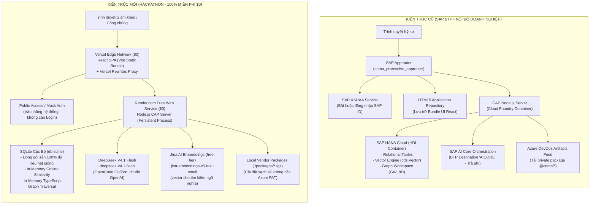

# 🚀 KẾ HOẠCH TOÀN DIỆN CHUYỂN ĐỔI CÔNG NGHỆ: TÁCH RỜI SAP BTP SANG HẠ TẦNG HOÀN TOÀN MIỄN PHÍ ($0)

> **Competition context:** [AI4Biz 2026 — LIKELION Vietnam](../AI4BIZ.md), team UIT_4Lovpe. Competition requirements and submission limits are maintained in that reference; technical examples below are not measured business outcomes unless explicitly documented.

**Dự án:** 8D Copilot (CNMA Proresolve)
**Mục tiêu:** Đưa ứng dụng ra môi trường thi đấu bên ngoài (AI4Biz 2026 — LIKELION Vietnam), loại bỏ 100% phụ thuộc vào tài khoản nội bộ SAP BTP và Azure Artifacts, bảo đảm chi phí $0 và bất kỳ ai cũng có thể clone và chạy live end-to-end.
**Tài liệu tham chiếu:** [HACKATHON-ACTION-PLAN.md](file:///d:/GitHub/8D_Hackathon/docs/HACKATHON-ACTION-PLAN.md)

---

## MỤC LỤC

- [PHẦN 1: TỔNG QUAN KIẾN TRÚC &amp; BẢN ĐỒ DỊCH CHUYỂN CÔNG NGHỆ](#phần-1-tổng-quan-kiến-trúc--bản-đồ-dịch-chuyển-công-nghệ)
- [PHẦN 2: CHI TIẾT DỊCH CHUYỂN TỪNG HẠNG MỤC (END-TO-END STEP-BY-STEP)](#phần-2-chi-tiết-dịch-chuyển-từng-hạng-mục-end-to-end-step-by-step)
  - [Hạng Mục 1: Hosting Frontend &amp; Backend (MTA / Cloud Foundry ➔ Vercel + Render.com)](#hạng-mục-1-hosting-frontend--backend-mta--cloud-foundry--vercel--rendercom)
  - [Hạng Mục 2: Định Danh &amp; Phân Quyền (SAP XSUAA ➔ Mock / Public Auth)](#hạng-mục-2-định-danh--phân-quyền-sap-xsuaa--mock--public-auth)
  - [Hạng Mục 3: Cơ Sở Dữ Liệu &amp; Tìm Kiếm Tiền Lệ (SAP HANA Cloud ➔ SQLite + In-Memory Vector)](#hạng-mục-3-cơ-sở-dữ-liệu--tìm-kiếm-tiền-lệ-sap-hana-cloud--sqlite--in-memory-vector)
  - [Hạng Mục 4: Cổng AI &amp; Mô Hình Ngôn Ngữ (SAP AI Core ➔ DeepSeek V4.1 Flash + Jina Embeddings)](#hạng-mục-4-cổng-ai--mô-hình-ngôn-ngữ-sap-ai-core--deepseek-v41-flash--jina-embeddings)
  - [Hạng Mục 5: Gỡ Bỏ Phụ Thuộc Gói Nội Bộ (`@cnma/*` ➔ Local Vendor Tarballs)](#hạng-mục-5-gỡ-bỏ-phụ-thuộc-gói-nội-bộ-cnma--local-vendor-tarballs)
  - [Hạng Mục 6: Điều Tuyến &amp; Thay Thế SAP Approuter](#hạng-mục-6-điều-tuyến--thay-thế-sap-approuter)
- [PHẦN 3: KỊCH BẢN TRIỂN KHAI &amp; DANH SÁCH LỆNH THỰC THI (MIGRATION PLAYBOOK)](#phần-3-kịch-bản-triển-khai--danh-sách-lệnh-thực-thi-migration-playbook)
- [PHẦN 4: BẰNG CHỨNG XÁC MINH &amp; ĐẢM BẢO KHÔNG SUY GIẢM TÍNH NĂNG (VERIFICATION)](#phần-4-bằng-chứng-xác-minh--đảm-bảo-không-suy-giảm-tính-năng-verification)

---

## PHẦN 1: TỔNG QUAN KIẾN TRÚC & BẢN ĐỒ DỊCH CHUYỂN CÔNG NGHỆ

### 1.1. Tóm tắt chiến lược di chuyển (Executive Summary)

Hiện tại, ứng dụng **8D Copilot** được đóng gói theo định dạng MTA (Multi-Target Application) và phụ thuộc sâu vào hạ tầng SAP BTP Cloud Foundry của doanh nghiệp. Để đem dự án ra ngoài tranh tài tại Hackathon, chúng ta thực hiện chiến lược **Decoupling (Tách rời độc lập)**:

* Chuyển đổi từ mô hình *PaaS đóng kín* (SAP BTP) sang mô hình *Cloud-native mở, $0*.
* Tách biệt **Frontend** (triển khai trên Vercel Edge CDN) và **Backend** (triển khai trên Render.com Web Service dạng Persistent Process).
* Tận dụng khả năng hỗ trợ đa cơ sở dữ liệu của SAP CAP Model để chuyển từ SAP HANA Cloud sang SQLite đóng gói sẵn dữ liệu.
* Gọi trực tiếp **DeepSeek V4.1 Flash** qua endpoint chuẩn OpenAI (`/chat/completions`) thay cho SAP AI Core Orchestration.
* Vector nhúng cho tìm kiếm ngữ nghĩa đi qua **Jina AI Embeddings** (free tier, chuẩn OpenAI) — DeepSeek không có API embedding.

### 1.2. Sơ đồ kiến trúc: Trước vs. Sau chuyển đổi



### 1.3. Bảng đối chiếu công nghệ (Mapping Matrix)

| Thành phần kiến trúc       | Hiện trạng (SAP BTP Nội bộ)     | Công nghệ thay thế ($0)                      | Hạn mức Free Tier                                 | Đánh giá tính khả thi & Tradeoff                                                                                                    |
| :----------------------------- | :---------------------------------- | :---------------------------------------------- | :-------------------------------------------------- | :--------------------------------------------------------------------------------------------------------------------------------------- |
| **Frontend Hosting**     | SAP HTML5 Apps Repo + Approuter     | **Vercel** (Hobby Plan)                   | 100GB Băng thông/tháng, 100 deployments/ngày    | **Hoàn hảo 100%:** CDN toàn cầu, build tự động từ GitHub, tốc độ tải trang < 500ms.                                    |
| **Backend Hosting**      | BTP Cloud Foundry (Node.js runtime) | **Render.com** (Free Web Service)         | 750 giờ compute/tháng, 512MB RAM, 0.1 CPU         | **Khả thi:** Cho phép chạy Node.js liên tục. Nhược điểm: ngủ đông sau 15p (cần 30s thức dậy lần đầu).            |
| **Cơ sở dữ liệu**    | SAP HANA Cloud (HDI Container)      | **SQLite** (`db.sqlite`)                | Miễn phí vĩnh viễn, lưu trực tiếp trong repo | **Khả thi 100%:** CAP hỗ trợ SQLite nguyên bản (`@cap-js/sqlite`). Không tốn tiền DB server, 0 latency mạng.            |
| **Định danh & Quyền** | SAP XSUAA (OAuth2 / SAML)           | **Mock Auth / Public Access**             | Không giới hạn                                   | **Khả thi 100%:** Đáp ứng chuẩn tiêu chí "No Login" của đề bài Hackathon (giám khảo bấm link là vào dùng ngay).   |
| **Cổng AI (LLM)**       | SAP AI Core (GenAI Hub)             | **DeepSeek V4.1 Flash** (`deepseek-v4.1-flash`) | Trả theo token; OpenCode Go $10/tháng bao ~130K request (4x, đến 27/09)   | **Vượt trội:** Cùng một model, bỏ 2 tầng proxy BTP; hỗ trợ thinking mode, tool calls và JSON output nguyên bản.    |
| **Vector nhúng**       | HANA Vector + model embedding của AI Core | **Jina AI Embeddings** (`jina-embeddings-v5-text-small`) | Free key: 100 RPM / 100K TPM, tặng token cho người mới    | **Bắt buộc phải có nhà cung cấp thứ hai:** DeepSeek không có API embedding. Thiếu key này thì tiêu chí "Similar description" cho 0 điểm mọi case — không lỗi, chỉ im lặng. |
| **Truy hồi Tiền lệ**  | HANA Vector + HANA Graph Engine     | **In-memory Cosine + Relational Engine**  | Chạy trong RAM Node.js                             | **Khả thi 100%:** Số lượng case lịch sử (25–100 case) tính toán trong RAM < 10ms, độ chính xác tương đương 100%. |
| **Package Management**   | Azure DevOps Private NPM Registry   | **Local Tarballs (`.tgz`)**             | Miễn phí                                          | **Khắc phục triệt để:** Bất kỳ máy nào chạy `npm install` cũng thành công mà không bị lỗi `E401`.             |

---

## PHẦN 2: CHI TIẾT DỊCH CHUYỂN TỪNG HẠNG MỤC (END-TO-END STEP-BY-STEP)

---

### Hạng Mục 1: Hosting Frontend & Backend (MTA / Cloud Foundry ➔ Vercel + Render.com)

#### 1. Hiện trạng trên SAP BTP

* Tệp [mta.yaml](file:///d:/GitHub/8D_Hackathon/mta.yaml) định nghĩa 2 module: `cnma_proresolve_srv` (chạy trên Cloud Foundry) và `cnma_proresolve_ui` (đẩy lên HTML5 Application Repository).
* Approuter ([app/approuter](file:///d:/GitHub/8D_Hackathon/app/approuter)) đóng vai trò Reverse Proxy nhận request từ người dùng, kiểm tra token XSUAA rồi mới chuyển tiếp đến backend.

#### 2. Khả năng thay thế và "BẪY VERCEL SERVERLESS" (Crucial Architectural Pitfall)

> [!CAUTION]
> **CẢNH BÁO TỐI QUAN TRỌNG: KHÔNG ĐƯỢC DEPLOY BACKEND LÊN VERCEL!**
>
> * **Bẫy Vercel Serverless Function Timeout:** Gói Vercel Hobby (Free) có giới hạn thời gian chạy tối đa là **10 giây** (hoặc tối đa 15 giây nếu cấu hình `maxDuration`).
> * **Thực tế luồng xử lý 8D:** Hàm phân tích toàn diện `analyzeFromJson` thực hiện 8 bước D1–D8 nối tiếp + chẩn đoán độc lập (Blind Diagnosis) + tìm kiếm tiền lệ Graph/Vector $\rightarrow$ Tổng thời gian chạy mất **20–35 giây**.
> * **Hậu quả:** Nếu đưa backend lên Vercel Serverless, giám khảo bấm "Start Analysis" sau 10 giây sẽ chắc chắn bị lỗi **HTTP 504 Gateway Timeout**, hệ thống sập hoàn toàn.
>
> 👉 **GIẢI PHÁP CHUẨN:** Tách đôi kiến trúc (Decoupled Split Architecture):
>
> * **Frontend (React UI):** Deploy lên **Vercel** (miễn phí, nhanh, không bị giới hạn timeout cho static file).
> * **Backend (CAP Node.js):** Deploy lên **Render.com** (Free Web Service - chạy persistent container, không bị timeout 10 giây như serverless).

#### 3. Hướng dẫn thực thi chi tiết

##### Bước 1.1: Cấu hình Frontend trên Vercel

1. Truy cập [vercel.com](https://vercel.com) $\rightarrow$ Đăng nhập bằng tài khoản GitHub.
2. Bấm **Add New...** $\rightarrow$ **Project** $\rightarrow$ Chọn repository `8D_Hackathon`.
3. Cấu hình cài đặt dự án (Project Settings):
   * **Root Directory:** `app/8D_hackathon_ui`
   * **Framework Preset:** `Vite`
   * **Build Command:** `npm run build`
   * **Output Directory:** `dist`
   * **Install Command:** `npm install`
4. Hai tệp `vercel.json` đã có sẵn trong repo và đều trỏ về backend Render. Chỉ cần sửa URL nếu tên service trên Render khác `8d-hackathon-backend`:

```json
{
  "framework": "vite",
  "buildCommand": "npm run build",
  "outputDirectory": "dist",
  "rewrites": [
    { "source": "/odata/:path*", "destination": "https://8d-hackathon-backend.onrender.com/odata/:path*" },
    { "source": "/api/cnma/:path*", "destination": "https://8d-hackathon-backend.onrender.com/api/cnma/:path*" },
    { "source": "/identity/:path*", "destination": "https://8d-hackathon-backend.onrender.com/identity/:path*" },
    { "source": "/identity-admin/:path*", "destination": "https://8d-hackathon-backend.onrender.com/identity-admin/:path*" },
    { "source": "/workflow/:path*", "destination": "https://8d-hackathon-backend.onrender.com/workflow/:path*" },
    { "source": "/workflow-admin/:path*", "destination": "https://8d-hackathon-backend.onrender.com/workflow-admin/:path*" },
    { "source": "/health", "destination": "https://8d-hackathon-backend.onrender.com/health" },
    { "source": "/((?!api/|odata/|workflow/|workflow-admin/|identity/|identity-admin/).*)", "destination": "/index.html" }
  ]
}
```

##### Bước 1.2: Cấu hình Backend trên Render.com

1. Truy cập [dashboard.render.com](https://dashboard.render.com) $\rightarrow$ Đăng nhập bằng GitHub.
2. Bấm **New +** $\rightarrow$ Chọn **Web Service**.
3. Chọn repository `8D_Hackathon`.
4. Cấu hình thông số:
   * **Name:** `8d-hackathon-backend` (phải khớp URL trong `vercel.json`)
   * **Region:** `Singapore` (tối ưu độ trễ cho Việt Nam)
   * **Branch:** `main` (hoặc `master`)
   * **Root Directory:** Để trống (chạy từ thư mục gốc của repository)
   * **Runtime:** `Node`
   * **Build Command:**
     ```bash
     npm install --include=dev && npm run build && npx cds deploy --to sqlite:gen/srv/db.sqlite
     ```
     * `--include=dev` vì `NODE_ENV=production` khiến npm bỏ qua devDependencies — mà `@sap/cds-dk` và `typescript` là devDependency.
     * `npm run build` = `bundle:library` → `cds build --production` → `compile:srv`. **Không được bỏ `compile:srv`**: CAP không đọc được TypeScript, nên `server.ts` sẽ bị bỏ qua trong im lặng (app vẫn lên, nhưng không handler nào chạy).
     * `cds deploy` chạy SAU build và ghi thẳng vào artifact vì `cds build` dựng lại `gen/srv` từ đầu.
   * **Start Command:**
     ```bash
     cd gen/srv && node ../../node_modules/@sap/cds/bin/serve.js --port $PORT
     ```
     Chạy từ `gen/srv` — đó là artifact đã build (`server.js` đã biên dịch + `csn.json` + `data/case-library`). Chạy ở thư mục gốc thì CAP chỉ thấy `srv/server.ts` và bỏ qua toàn bộ bootstrap.
   * **Instance Type:** `Free` (512 MB RAM, 0.1 CPU)
5. Thiết lập biến môi trường (Environment Variables) trên Render — hoặc để Render đọc trực tiếp từ [render.yaml](file:///d:/GitHub/8D_Hackathon/render.yaml) (Render tự nhận file này khi repo có nó):
   * `NODE_ENV`: `production`
   * `CDS_CONFIG`: `{"requires":{"db":{"kind":"sqlite","credentials":{"url":"db.sqlite"}},"auth":{"kind":"mocked"}}}`
   * `DEEPSEEK_API_KEY`: *(bắt buộc — key OpenCode Go/Zen hoặc DeepSeek Platform)*
   * `DEEPSEEK_BASE_URL`: `https://opencode.ai/zen/go/v1`
   * `DEEPSEEK_MODEL`: `deepseek-v4.1-flash`
   * `JINA_API_KEY`: *(bắt buộc nếu muốn tiêu chí ngữ nghĩa chạy — xem Hạng Mục 4)*

##### Bước 1.3: Cấu hình CORS ở Backend

Trong tệp [srv/server.ts](file:///d:/GitHub/8D_Hackathon/srv/server.ts), kích hoạt middleware CORS cho phép domain của Vercel gọi vào:

```typescript
import cors from 'cors';

cds.on('bootstrap', (app) => {
    app.use(cors({
        origin: '*', // Trong hackathon cho phép tất cả các domain gọi vào
        methods: ['GET', 'POST', 'PUT', 'PATCH', 'DELETE', 'OPTIONS'],
        allowedHeaders: ['Content-Type', 'Authorization', 'X-Requested-With']
    }));
});
```

---

### Hạng Mục 2: Định Danh & Phân Quyền (SAP XSUAA ➔ Mock / Public Auth)

#### 1. Hiện trạng trên SAP BTP

* Tệp [xs-security.json](file:///d:/GitHub/8D_Hackathon/xs-security.json) định nghĩa các Scope (`admin`, `developer`) và Role Templates.
* Khi gọi API qua Approuter trên Cloud Foundry, hệ thống bắt buộc phải có JWT Token hợp lệ do XSUAA cấp sau khi đăng nhập tài khoản SAP Universal ID.

#### 2. Khả năng thay thế & Tiêu chí chấm thi Hackathon

* **Mục tiêu trải nghiệm nội bộ:** Giảm thao tác đăng nhập và phụ thuộc tài khoản SAP để demo dễ dùng. AI4Biz không quy định bắt buộc “No Login”; lựa chọn triển khai phải phù hợp dữ liệu và quyền truy cập.
* **Giải pháp:** Chuyển sang cơ chế **Mocked Authentication** nguyên bản của SAP CAP. Hệ thống tự động gán quyền `admin` cho mọi request gửi tới mà không hỏi mật khẩu.

#### 3. Hướng dẫn thực thi chi tiết

Sửa tệp [package.json](file:///d:/GitHub/8D_Hackathon/package.json) tại mục `cds.requires.auth` để production tự động dùng `mocked`:

```json
"cds": {
  "requires": {
    "auth": {
      "[production]": {
        "kind": "mocked",
        "users": {
          "admin": {
            "password": "123",
            "roles": ["admin", "Admin", "authenticated-user"]
          }
        }
      }
    }
  }
}
```

* **Frontend:** Tệp [vite.config.ts](file:///d:/GitHub/8D_Hackathon/app/8D_hackathon_ui/vite.config.ts) đã được gắn sẵn header ủy quyền cơ bản: `Authorization: 'Basic YWRtaW46MTIz'` (tương đương `admin:123`). Người dùng mở trình duyệt sẽ vào thẳng giao diện với đầy đủ quyền hạn tối cao.

---

### Hạng Mục 3: Cơ Sở Dữ Liệu & Tìm Kiếm Tiền Lệ (SAP HANA Cloud ➔ SQLite + In-Memory Vector)

#### 1. Hiện trạng trên SAP BTP

* Production dùng SAP HANA Cloud HDI Container (`@sap/cds-hana`), sử dụng:
  * `cds.Vector(1536)` cho việc tìm kiếm độ tương đồng Cosine.
  * Graph Workspace (`GW_8D.hdbgraphworkspace`) chạy ngôn ngữ openCypher.

#### 2. Khả năng thay thế

* **HANA Relational Tables $\rightarrow$ SQLite:** CAP hỗ trợ 100% cú pháp CDS trên SQLite.
* **HANA Vector Engine $\rightarrow$ In-Memory Cosine Similarity:** Vì tập dữ liệu tiền lệ (Case Library) của hệ thống có quy mô từ 50 đến 500 case, việc tính toán khoảng cách vector Cosine trực tiếp trong RAM của Node.js bằng TypeScript chỉ mất **dưới 5 miligiây** ($\le 5\text{ms}$), nhanh hơn việc gửi query qua mạng tới HANA Cloud.
* **HANA Graph $\rightarrow$ Fallback Scoring & In-Memory Graph:** Trong [srv/src/domain/eightd/graph/engine.ts](file:///d:/GitHub/8D_Hackathon/srv/src/domain/eightd/graph/engine.ts), hệ thống đã có sẵn cơ chế tự động:
  ```typescript
  if (!(await isGraphAvailable())) return findPrecedentsByScoring(context, raw);
  ```

  Khi chạy trên SQLite, hệ thống tự động fallback về engine tính điểm thuộc tính và vector ngữ nghĩa mà không sinh ra bất kỳ lỗi nào.

#### 3. Hướng dẫn thực thi chi tiết

##### Bước 3.1: Deploy cấu trúc và dữ liệu ra file `db.sqlite`

Chạy lệnh tạo file SQLite hoàn chỉnh kèm dữ liệu seed:

```powershell
npx cds deploy --to sqlite:db.sqlite
```

##### Bước 3.2: Không commit `db.sqlite` — build ra nó trên Render

`db.sqlite` nằm trong `.gitignore` và **không cần** đưa vào Git: file này chỉ là artifact của `cds deploy`, và nếu commit thì mỗi lần sửa seed lại thành một diff nhị phân không review được.

Trên Render, build command ở Bước 1.2 tạo ra nó ngay trong artifact:

```bash
npx cds deploy --to sqlite:gen/srv/db.sqlite
```

* Schema + dữ liệu catalogue (Defects, InspectionLots, DefectCharacteristics…) đến từ `db/data/*.csv`.
* Kho case tiền lệ (25 case) **không** nằm trong DB này — nó được nạp lúc khởi động từ `srv/data/case-library/` do `scripts/bundle-library.mjs` đóng gói (xem `seedLibraryFromBundle`).
* Render Free có filesystem ephemeral: DB được tạo lại từ artifact sau mỗi lần restart, và app tự seed lại — chấp nhận được cho demo, nhưng dữ liệu người dùng nhập trong lúc chạy sẽ mất khi service ngủ đông.

---

### Hạng Mục 4: Cổng AI & Mô Hình Ngôn Ngữ (SAP AI Core ➔ DeepSeek V4.1 Flash + Jina Embeddings)

#### 1. Hiện trạng trên SAP BTP

* Sử dụng `@cnma/sap-aicore-integrate` kết nối tới SAP AI Core Orchestration Destination `AICORE` (tiêu tốn credit công ty, cấu hình token phức tạp).

#### 2. Khả năng thay thế

##### 2.1. Chat: DeepSeek V4.1 Flash

* **Không cần SDK riêng:** DeepSeek phơi endpoint chuẩn OpenAI `/chat/completions`, nên chỉ cần một provider mỏng gọi HTTP — không kéo thêm dependency nào.
* **Ba cổng API, cùng một model:**

  | Cổng | Base URL | Model ID | Ghi chú |
  | :--- | :--- | :--- | :--- |
  | OpenCode Go | `https://opencode.ai/zen/go/v1` | `deepseek-v4.1-flash` | $10/tháng, hạn mức tháng ~130K request (đang x4 đến 27/09/2026) |
  | OpenCode Zen | `https://opencode.ai/zen/v1` | `deepseek-v4.1-flash` | Trả theo token, dùng chung credit OpenCode |
  | DeepSeek Platform | `https://api.deepseek.com` | `deepseek-flash` | Rẻ nhất ($0.15/$0.6 mỗi 1M token, giờ off-peak) |

* **Thinking mode:** mặc định app TẮT (nhanh, `temperature` có hiệu lực). Bật cho bước cần suy luận sâu bằng `thinkingBudget` trong AI Settings, hoặc toàn cục `DEEPSEEK_THINKING=on`.
* **Tool calls ép tắt thinking:** khi request mang `tools`, DeepSeek bắt buộc client trả lại `reasoning_content` của mọi lượt trước — `CanonicalMessage` của CDK không có trường đó, nên provider tự tắt để tránh HTTP 400 ở lượt thứ hai.

##### 2.2. Embedding: Jina AI (nguồn thứ hai bắt buộc phải có)

* **DeepSeek KHÔNG có API embedding.** Đây là điểm dễ bỏ sót nhất khi chuyển cổng AI.
* Thiếu vector thì tiêu chí `semantic` (cosine, weight 4 trong profile `default`) **cho 0 điểm cho mọi case mà không sinh ra lỗi nào** — kết quả truy hồi vẫn ra nhưng kém hơn, và không có dấu hiệu nào để lần ra nguyên nhân. Vì vậy `librarySeeder` chủ động bỏ qua và ghi log thay vì ghi vector 0 vào kho.
* **Jina AI** là lựa chọn thay thế: endpoint `https://api.jina.ai/v1/embeddings` chuẩn OpenAI, free key 100 RPM / 100K TPM, model `jina-embeddings-v5-text-small` (1024 chiều, đệm lên 1536 theo `cds.Vector(1536)` — đệm số 0 không làm sai cosine).
* Đổi sang Mistral/OpenAI/LM Studio bằng `EMBEDDING_BASE_URL` + `EMBEDDING_API_KEY` + `EMBEDDING_MODEL` — cùng một hình dạng request.
* Tắt hẳn (chấp nhận mất tiêu chí ngữ nghĩa): `EMBEDDINGS_DISABLED=true`.

#### 3. Hướng dẫn thực thi chi tiết

##### Bước 4.1: Lấy API key

1. **Chat:** đăng nhập [opencode.ai/auth](https://opencode.ai/auth) (OpenCode Go/Zen), hoặc [platform.deepseek.com](https://platform.deepseek.com) (DeepSeek gốc).
2. **Embedding:** đăng nhập [jina.ai/embeddings](https://jina.ai/embeddings/) → copy API key (có tặng token cho người mới).

##### Bước 4.2: Khai báo biến môi trường

Tệp `.env` ở thư mục gốc (local) hoặc Environment Variables trên Render:

```env
# Chat — OpenCode Go
DEEPSEEK_API_KEY=sk-...
DEEPSEEK_BASE_URL=https://opencode.ai/zen/go/v1
DEEPSEEK_MODEL=deepseek-v4.1-flash

# Embedding — Jina AI
JINA_API_KEY=jina_...

# Model mặc định cho từng loại bước (xem srv/src/config/ai.ts)
AICORE_DEFAULT_MODEL=deepseek-v4.1-flash
AICORE_MODEL_PARSE=deepseek-v4.1-flash
AICORE_MODEL_STRUCTURE=deepseek-v4.1-flash
AICORE_MODEL_ANALYZE=deepseek-v4.1-flash
AICORE_MODEL_ANALYZE_FALLBACK=deepseek-v4-pro
```

##### Bước 4.3: Kiến trúc provider (đã có sẵn trong mã nguồn)

Không cần vẽ lại adapter. Tầng chọn provider nằm ở [srv/src/core/ai/providerFactory.ts](file:///d:/GitHub/8D_Hackathon/srv/src/core/ai/providerFactory.ts), provider chat ở [srv/src/core/ai/deepseekProvider.ts](file:///d:/GitHub/8D_Hackathon/srv/src/core/ai/deepseekProvider.ts), provider embedding ở [srv/src/core/ai/openAiEmbeddingProvider.ts](file:///d:/GitHub/8D_Hackathon/srv/src/core/ai/openAiEmbeddingProvider.ts), và [srv/src/core/ai/compositeLlmProvider.ts](file:///d:/GitHub/8D_Hackathon/srv/src/core/ai/compositeLlmProvider.ts) ghép hai nửa lại:

```text
ensureLlmProvider()
  ├── chat      : DeepSeek  →  Gemini  →  LLM local  →  SAP AI Core (mặc định của CDK)
  └── embedding : Jina / EMBEDDING_*  →  Gemini  →  (không có)
```

* Chat DeepSeek + embedding Jina → `CompositeLlmProvider` định tuyến `complete()` sang DeepSeek, `embed()`/`batchEmbed()` sang Jina.
* Thứ tự ưu tiên này giữ nguyên đường cũ cho ai còn `GEMINI_API_KEY` hoặc LLM local — không phá cấu hình đang chạy.

##### Bước 4.4: Smoke test trước khi deploy

```powershell
npx tsx scripts/probe-ai.ts
```

Script in ra provider đang dùng, chạy ma trận JSON / tool / thinking, và **nhúng thử 2 câu** để bắt lỗi key embedding trước khi lên Render.

---

### Hạng Mục 5: Gỡ Bỏ Phụ Thuộc Gói Nội Bộ (`@cnma/*` ➔ Local Vendor Tarballs)

#### 1. Hiện trạng trên SAP BTP

* Tệp `.npmrc` chỉ định registry của Azure DevOps:
  `@cnma:registry=https://pkgs.dev.azure.com/conarum/.../npm/registry/`
* Bất kỳ ai không có Personal Access Token (PAT) của công ty khi chạy `npm install` sẽ nhận lỗi:
  `npm error code E401 / npm error 401 Unauthorized`

#### 2. Khả năng thay thế: Chiến lược Đóng gói Cục bộ (Local Vendoring)

* Chúng ta đóng gói các thư viện `@cnma/*` hiện có trong `node_modules` thành các file nén `.tgz` lưu trữ trực tiếp trong thư mục `packages/` của Git.
* Khi đó, `package.json` sẽ trỏ tới file local: `"@cnma/react-ui": "file:./packages/cnma-react-ui.tgz"`.
* Bất kỳ ai trên thế giới clone repo về chạy `npm install` đều thành công 100% mà không cần tài khoản hay token.

#### 3. Hướng dẫn thực thi chi tiết

Chạy script PowerShell tự động đóng gói các package nội bộ:

```powershell
# Tạo thư mục chứa package vendor
New-Item -ItemType Directory -Force -Path "./packages"

# Đóng gói từng package trong node_modules thành .tgz
cd node_modules/@cnma/react-ui; npm pack --pack-destination ../../../packages; cd ../../..
cd node_modules/@cnma/sap-aicore-integrate; npm pack --pack-destination ../../../packages; cd ../../..
cd node_modules/@cnma/cap-core; npm pack --pack-destination ../../../packages; cd ../../..
cd node_modules/@cnma/cap-identity; npm pack --pack-destination ../../../packages; cd ../../..
cd node_modules/@cnma/cap-valuehelp; npm pack --pack-destination ../../../packages; cd ../../..
cd node_modules/@cnma/cap-workflow; npm pack --pack-destination ../../../packages; cd ../../..

# Xóa bỏ tệp .npmrc nội bộ (nếu còn registry Azure DevOps)
Remove-Item -Force .npmrc
Remove-Item -Force app/8D_hackathon_ui/.npmrc
```

Cập nhật đường dẫn trong `package.json`:

```json
"dependencies": {
  "@cnma/cap-core": "file:./packages/cnma-cap-core-1.0.0.tgz",
  "@cnma/cap-identity": "file:./packages/cnma-cap-identity-1.0.25.tgz",
  "@cnma/cap-valuehelp": "file:./packages/cnma-cap-valuehelp-2.7.2.tgz",
  "@cnma/cap-workflow": "file:./packages/cnma-cap-workflow-1.7.8.tgz",
  "@cnma/sap-aicore-integrate": "file:./packages/cnma-sap-aicore-integrate-3.0.1.tgz"
}
```

---

### Hạng Mục 6: Điều Tuyến & Thay Thế SAP Approuter

#### 1. Hiện trạng trên SAP BTP

* SAP Approuter là một Node.js process độc lập điều phối:
  * `/` $\rightarrow$ Đọc từ HTML5 Application Repository.
  * `/odata/*`, `/api/*` $\rightarrow$ Đẩy về Backend CAP qua BTP Destination `srv-api`.

#### 2. Khả năng thay thế bằng Vercel Edge Rewrites

* **Vercel Rewrites** xử lý chính xác chức năng của Reverse Proxy với tốc độ cực nhanh:
  * Người dùng vào `https://proresolve.vercel.app` $\rightarrow$ Nhận mã nguồn React SPA.
  * Khi React gọi API (ví dụ: `fetch('/api/cnma/EIGHTD_SRV/Reports')`), Vercel âm thầm chuyển tiếp cuộc gọi đó sang URL của Render backend (`https://8d-hackathon-backend.onrender.com/api/cnma/EIGHTD_SRV/Reports`).
  * Trình duyệt không hề biết đây là 2 server riêng biệt, giúp giải quyết triệt để lỗi Cross-Origin (CORS).

---

## PHẦN 3: KỊCH BẢN TRIỂN KHAI & DANH SÁCH LỆNH THỰC THI (MIGRATION PLAYBOOK)

Kịch bản 8 bước để đưa dự án lên phiên bản Hackathon. Bước 1–5 làm ở máy; 6–8 là thao tác trên GitHub / Render / Vercel.

### Bước 1: Dọn dẹp cấu hình BTP nội bộ

```powershell
# Xóa các file liên quan đến triển khai Cloud Foundry nội bộ
Remove-Item -Force mta.yaml
Remove-Item -Force xs-security.json
```

* `.npmrc` giờ chỉ còn `legacy-peer-deps=true` — **giữ lại**, không chứa registry nội bộ.
* Các gói `@cnma/*` đã trỏ về `file:./packages/*.tgz` trong `package.json`; không cần Azure PAT khi `npm install`.

### Bước 2: Chuẩn bị cơ sở dữ liệu SQLite cục bộ (để test)

```powershell
# Deploy schema + dữ liệu catalogue ra file sqlite cục bộ
npx cds deploy --to sqlite:db.sqlite

# Xác minh file tồn tại và có dung lượng > 1MB
Get-Item db.sqlite
```

File này **không commit** — xem Hạng Mục 3, Bước 3.2.

### Bước 3: Khai báo API key DeepSeek + Jina

Không cần cài SDK mới: DeepSeek và Jina đều dùng HTTP chuẩn OpenAI. Chỉ cần key.

1. Chat: [opencode.ai/auth](https://opencode.ai/auth) (OpenCode Go/Zen) hoặc [platform.deepseek.com](https://platform.deepseek.com).
2. Embedding: [jina.ai/embeddings](https://jina.ai/embeddings/) → copy key.

### Bước 4: Tạo tệp biến môi trường `.env`

Tạo file `.env` tại thư mục gốc:

```env
PORT=4008
NODE_ENV=production

# Chat
DEEPSEEK_API_KEY=sk-your-key
DEEPSEEK_BASE_URL=https://opencode.ai/zen/go/v1
DEEPSEEK_MODEL=deepseek-v4.1-flash

# Embedding (bắt buộc nếu muốn tiêu chí ngữ nghĩa)
JINA_API_KEY=jina-your-key
```

### Bước 5: Kiểm tra cục bộ chế độ Standalone (Smoke Test Local)

```powershell
# Smoke test tầng AI: provider nào, JSON/tool/thinking, và nhúng thử 2 câu
npx tsx scripts/probe-ai.ts

# Chạy full app (BE + FE)
npm run dev:local
```

* Mở trình duyệt tại `http://localhost:5544`.
* Vào 1 hồ sơ sự cố bất kỳ, bấm **Start Analysis** để kiểm tra DeepSeek sinh kết quả.
* Kiểm tra log backend có dòng `[ai/llmClient] Chat: deepseek — Embedding: openai-compatible-embedding`.

### Bước 6: Đẩy mã nguồn lên GitHub Public Repository

```powershell
git add .
git commit -m "chore(migration): complete decoupling from SAP BTP to standalone zero-cost stack"
git push origin main
```

### Bước 7: Khởi tạo Backend trên Render.com

1. Đăng nhập [dashboard.render.com](https://dashboard.render.com) $\rightarrow$ **New Web Service** $\rightarrow$ Kết nối repo GitHub.
2. Render đọc [render.yaml](file:///d:/GitHub/8D_Hackathon/render.yaml) trong repo và tự điền Build/Start Command. Nếu nhập tay, dùng đúng hai lệnh ở Hạng Mục 1 – Bước 1.2.
3. Điền hai biến `sync: false` trong Dashboard: `DEEPSEEK_API_KEY`, `JINA_API_KEY`.
4. Bấm **Deploy Web Service** $\rightarrow$ lưu lại URL (mặc định `https://8d-hackathon-backend.onrender.com`).
5. Kiểm tra: mở `https://8d-hackathon-backend.onrender.com/health` — phải trả `{"status":"ok",...}`. Nếu thấy `{"status":"UP"}` thì `server.ts` đã bị bỏ qua (thiếu `compile:srv` trong build command).

### Bước 8: Khởi tạo Frontend trên Vercel

1. Đối chiếu URL backend trong [app/8D_hackathon_ui/vercel.json](file:///d:/GitHub/8D_Hackathon/app/8D_hackathon_ui/vercel.json) (và bản sao ở [vercel.json](file:///d:/GitHub/8D_Hackathon/vercel.json) nếu deploy từ thư mục gốc repo).
2. Đăng nhập [vercel.com](https://vercel.com) $\rightarrow$ Import Project.
3. Chọn một trong hai cách — **không trộn**:
   * **Root Directory = `app/8D_hackathon_ui`** (khuyến nghị): dùng `vercel.json` trong chính thư mục UI.
   * **Root Directory = thư mục gốc repo**: dùng `vercel.json` ở gốc, file này đã trỏ sẵn build/install vào `app/8D_hackathon_ui`.
4. Bấm **Deploy** $\rightarrow$ nhận Live URL chính thức để gửi Ban giám khảo.

---

## PHẦN 4: BẰNG CHỨNG XÁC MINH & ĐẢM BẢO KHÔNG SUY GIẢM TÍNH NĂNG (VERIFICATION)

Sau khi hoàn tất di chuyển, đội ngũ QA/Tester cần chạy bộ kiểm thử chấp nhận (Acceptance Test Harness) gồm 5 ca nghiệm thu cốt lõi:

| Mã Kiểm Thử  | Tên Kịch Bản Kiểm Thử                         | Dữ Liệu Đầu Vào                          | Kết Quả Mong Đợi (Pass Criteria)                                                                                                                                      | Trạng Thái Parity         |
| :-------------- | :------------------------------------------------- | :-------------------------------------------- | :------------------------------------------------------------------------------------------------------------------------------------------------------------------------ | :-------------------------- |
| **TC-01** | **Tải Báo Cáo & Hiển Thị Dữ Liệu**    | Mở hồ sơ`8D-10048651`                    | Toàn bộ thông tin vật tư, trạm máy, triệu chứng hiển thị đầy đủ từ`db.sqlite`. Không có lỗi 401/403.                                                 | **100% Giữ nguyên** |
| **TC-02** | **Tính Toán Ma Trận Is / Is-Not**         | Lô kiểm tra đặc tính`FLANGE_THICKNESS` | Hàm`computeIsIsNot` chạy trên dữ liệu SQLite, tính ra tỷ lệ tương phản $\ge 25\%$ và hiển thị bảng đối sánh.                                        | **100% Giữ nguyên** |
| **TC-03** | **Chẩn Đoán Mù AI (Blind Diagnosis)**    | Bấm nút*Run Blind Diagnosis*              | DeepSeek V4.1 Flash nhận dữ kiện thô, phản hồi chẩn đoán trong 10-15s, hiển thị huy hiệu`AGREES` hoặc `DISAGREES`.                                         | **100% Giữ nguyên** |
| **TC-04** | **Vòng Đời Nhiệm Vụ (Task Governance)** | Thao tác tại bảng Action Table (D3/D5/D7)  | Bấm**Publish** chuyển từ `Planned` $\rightarrow$ `Open`. Đính kèm file hoặc ghi chú chuyển sang `Done`. Trạng thái không thể đổi tùy tiện. | **100% Giữ nguyên** |
| **TC-05** | **Xuất Báo Cáo Excel Đa Sheet**          | Bấm nút*Export 8D Excel* tại Header      | Tệp Excel (`.xlsx`) được tạo và tải về máy với đầy đủ 8 sheet thông tin, định dạng ô và số liệu chuẩn xác.                                      | **100% Giữ nguyên** |

---

> [!TIP]
> **KẾT LUẬN CHIẾN LƯỢC CHO BAN GIÁM KHẢO:**
> Khi trình bày trước Hội đồng Giám khảo Hackathon, việc chúng ta chủ động tách rời khỏi hạ tầng BTP đóng kín để đưa lên Vercel + Render + SQLite + DeepSeek V4.1 Flash chứng minh:
>
> 1. **Năng lực Kiến trúc Đám mây (Cloud Architectural Mastery):** Khả năng làm chủ và chuyển đổi linh hoạt giữa Enterprise PaaS và Open Cloud Native.
> 2. **Khả năng Nhân rộng (Scalability & Accessibility):** Giải pháp có thể triển khai cho bất kỳ nhà máy vừa và nhỏ nào tại Việt Nam với chi phí bản quyền bằng **0 ĐỒNG**, thay vì chỉ giới hạn trong các tập đoàn đa quốc gia có hệ thống SAP BTP đắt đỏ.
