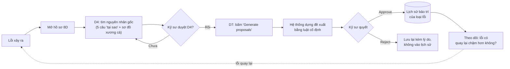
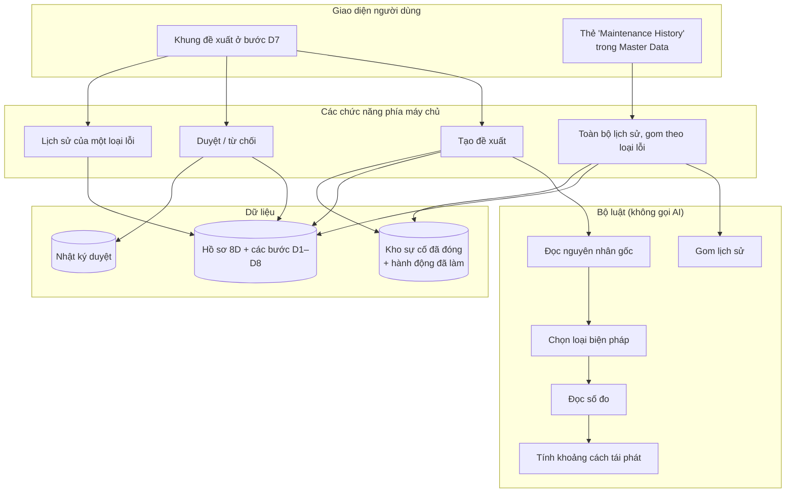
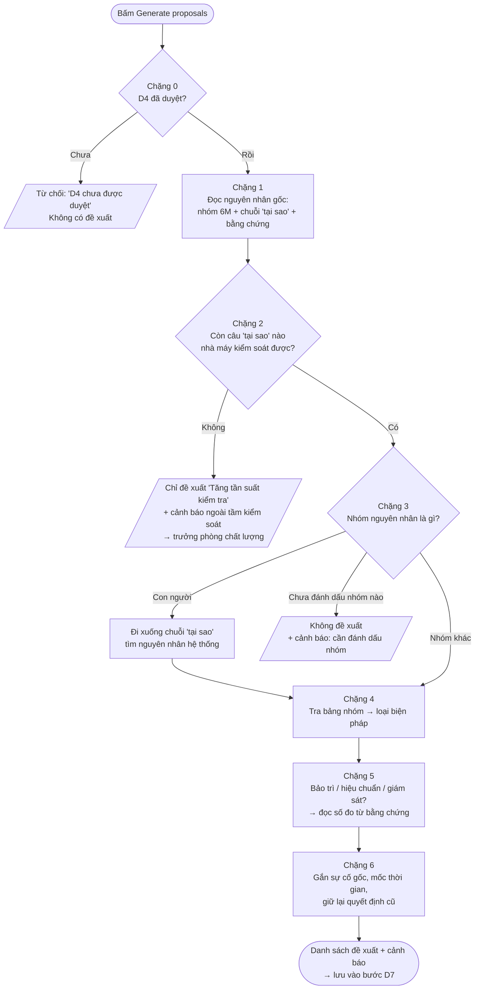
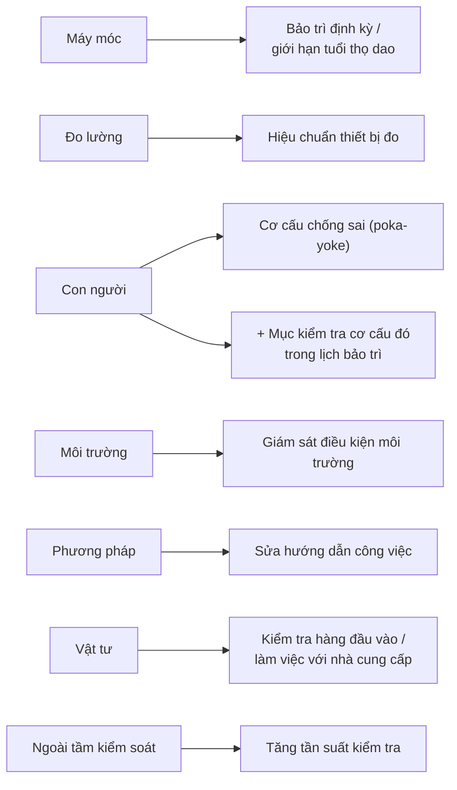
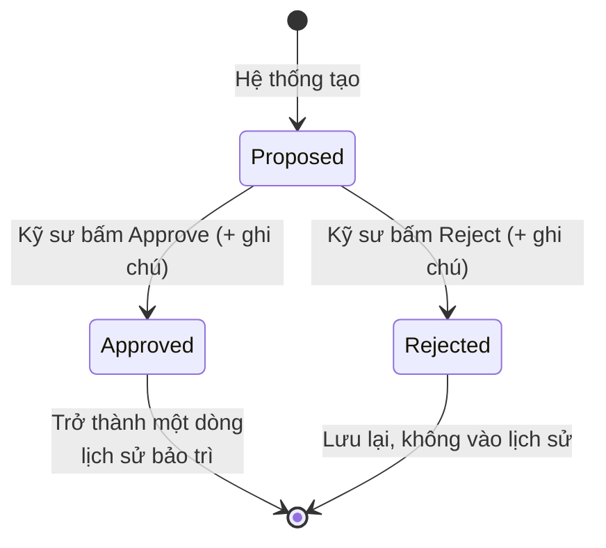
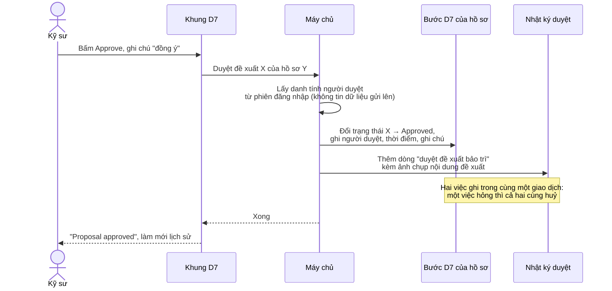
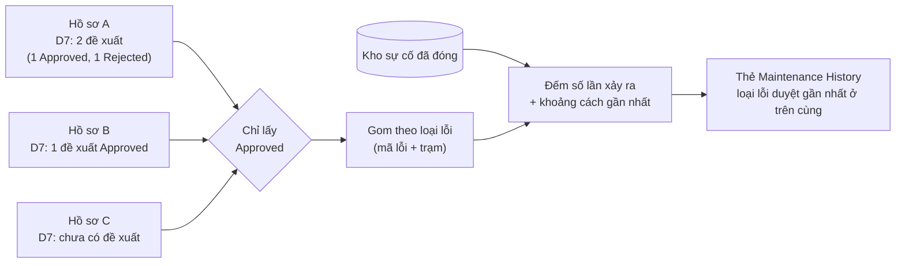
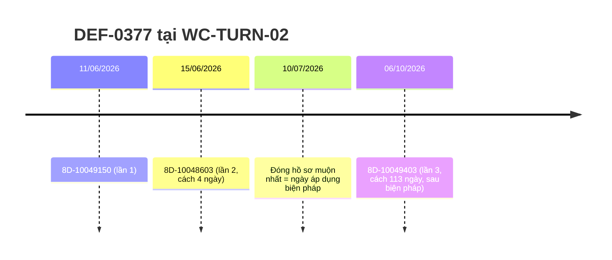

# Kiến thức tính năng: Lịch sử bảo trì & Đề xuất bảo trì phòng ngừa

> **AI4Biz submission status:** This is preparation/reference material, not a confirmed final submission. Slides and presentation must be in English; PDF ≤15 slides, demo video ≤2 minutes, final pitch ≤15 minutes plus 5-minute Q&A, with at least 3 presenting members. Any longer Vietnamese script is a rehearsal reference and must be adapted before submission.

> **Competition context:** [AI4Biz 2026 — LIKELION Vietnam](https://app.notion.com/p/likelion/AI-FOR-BUSINESS-INNOVATION-3f744860a4f480ab920ddb3911a25c21), team UIT_4Lovpe. Competition requirements and submission limits are maintained in that reference; technical examples below are not measured business outcomes unless explicitly documented.

> **Dành cho:** người thuyết trình vòng chung kết (17/10/2026).
> **Mục đích:** giúp bạn hiểu tận gốc tính năng mới: nó sinh ra để giải bài toán nào, dữ liệu đi qua những bước nào, ở mỗi bước hệ thống quyết định ra sao, làm được gì và chưa làm được gì. Đây không phải kịch bản nói. Hiểu xong, bạn tự trả lời giám khảo bằng lời của mình.
> **Soạn bởi:** Duy. Đây là ý tưởng của Duy, chưa thảo luận với bạn, nên tài liệu viết từ con số 0.
> **Cách đọc:**
> - Mỗi phần giải thích bằng lời thường trước. Dòng **📎 Code** ở cuối chỉ tới chỗ cài đặt thật, để bạn kiểm chứng khi cần.
> - Sơ đồ viết bằng Mermaid, xem được trực tiếp trên GitHub hoặc VS Code.
> - Code tham chiếu là bản trên nhánh `main`, commit `d4d10b0`.

---

## Mục lục
1. Bài toán ban tổ chức đặt ra và cách team hiểu nó
2. Ý tưởng cốt lõi
3. Bức tranh tổng thể (sơ đồ)
4. Dữ liệu đầu vào: hệ thống đọc gì, ở đâu
5. Pipeline tạo đề xuất, từng chặng một
6. Vòng đời một đề xuất: tạo → duyệt → thành lịch sử
7. Lịch sử bảo trì được dựng ra sao
8. Đo hiệu quả: khoảng cách giữa các lần lỗi quay lại
9. Bốn "cái chặn" để hệ thống không bịa
10. Ba ví dụ chạy thật trên dữ liệu
11. Giới hạn đã biết
12. Câu hỏi giám khảo có thể hỏi
13. Hướng phát triển
14. Từ điển nhanh và bản đồ code

---

## 1. Bài toán ban tổ chức đặt ra và cách team hiểu nó

**Yêu cầu nguyên văn (ý):** cần có lịch sử bảo trì cho từng loại lỗi, để nhà máy chủ động bảo trì, không phải đợi lỗi xảy ra rồi mới xử lý.

**Tình trạng thực tế của dự án khi nhận yêu cầu:**
- Ứng dụng xoay quanh quy trình 8D: lỗi xảy ra → mở hồ sơ 8D → tìm nguyên nhân → khắc phục → phòng ngừa → đóng hồ sơ. Đây là cách làm **phản ứng sau sự cố**.
- Ứng dụng **không có** sổ bảo trì, danh sách thiết bị, hay dữ liệu cảm biến của máy.
- Nhưng ứng dụng **có** một kho hồ sơ 8D, trong đó nguyên nhân gốc đã được kỹ sư tìm ra và ký duyệt.

**Cách team hiểu yêu cầu:**
"Chủ động" không nhất thiết là đoán trước tương lai. Chủ động là: **mỗi lần đã hiểu rõ vì sao một lỗi xảy ra, biến hiểu biết đó thành một việc làm định kỳ để lỗi không quay lại**, rồi theo dõi xem lỗi có quay lại thật không.

---

## 2. Ý tưởng cốt lõi

Ba câu cần nhớ:

1. **Đầu vào là kiến thức đã được duyệt, không phải phỏng đoán.** Hệ thống chỉ dùng nguyên nhân gốc ở bước D4 khi kỹ sư đã bấm duyệt.
2. **Đầu ra là đề xuất, con người quyết.** Hệ thống đề xuất việc cần làm, còn kỹ sư duyệt hoặc từ chối. Chỉ đề xuất được duyệt mới được tính là lịch sử bảo trì.
3. **Lịch sử tự lớn lên và đo được.** Mỗi hồ sơ 8D được xử lý thêm một dòng vào lịch sử của loại lỗi đó. Hiệu quả đo bằng số ngày thật giữa các lần lỗi quay lại.

**Vì sao không làm "AI dự đoán khi nào máy hỏng"?**
- Không có dữ liệu để đoán. Đoán không có dữ liệu là bịa.
- Sản phẩm có một nguyên tắc xuyên suốt: *thà không nói còn hơn nói điều thiếu căn cứ*. Ví dụ ở bài kiểm tra số 4 của ban tổ chức, hệ thống từ chối đưa ra một ca tương tự kém liên quan và chuyển câu hỏi cho người.
- Kiến thức đáng tin nhất, tức nguyên nhân gốc đã được kiểm chứng, đã nằm sẵn trong hệ thống.

📎 **Code:** lý do thiết kế được ghi ngay đầu file luật [rules.ts](../srv/src/domain/eightd/maintenance/rules.ts), dòng 1–27.

---

## 3. Bức tranh tổng thể

### 3.1. Từ một sự cố tới lịch sử bảo trì

### 3.2. Các thành phần trong hệ thống

📎 **Code:**
- Giao diện: [maintenance-panel.tsx](../app/8D_hackathon_ui/src/pages/eight-d/maintenance-panel.tsx) và [MaintenanceHistoryTab.tsx](../app/8D_hackathon_ui/src/pages/master-data/MaintenanceHistoryTab.tsx).
- Bốn chức năng máy chủ được khai báo trong [EightDService.cds](../srv/EightDService.cds): `proposeMaintenancePlan`, `decideMaintenanceProposal`, `getMaintenanceHistory`, `listMaintenanceHistory`.
- Bộ luật: [rules.ts](../srv/src/domain/eightd/maintenance/rules.ts).
- Đọc và ghi dữ liệu: [maintenanceStore.ts](../srv/src/domain/eightd/maintenance/maintenanceStore.ts).

---

## 4. Dữ liệu đầu vào: hệ thống đọc gì, ở đâu

| Hệ thống cần biết | Lấy từ đâu | Ghi chú |
|---|---|---|
| Sự cố này thuộc **loại lỗi** nào | Hồ sơ 8D: mã lỗi + trạm sản xuất | Loại lỗi = cùng mã lỗi **và** cùng trạm |
| Ngày phát hiện sự cố này | Hồ sơ 8D | Dùng để vẽ mốc thời gian |
| D4 đã được duyệt chưa | Trạng thái duyệt của bước D4 | Chưa duyệt thì từ chối, không làm gì tiếp |
| Nhóm nguyên nhân gốc | Bước D4: nhóm được đánh dấu "là nguyên nhân" trên sơ đồ xương cá | Thứ tự ưu tiên: nhóm kỹ sư xác nhận → dòng đầu tiên được đánh dấu → nhóm ghi trong phần nguyên nhân → nhóm ghi trên hồ sơ |
| Chuỗi 5 câu "tại sao" | Bước D4 | Đọc theo thứ tự từ nông đến sâu |
| Bằng chứng có số | Mô tả và số đo của các dòng được đánh dấu "là nguyên nhân" | Nơi duy nhất được phép lấy con số |
| Các lần lỗi cùng loại trước đây | Kho sự cố **đã đóng** cùng mã lỗi + cùng trạm, trừ chính sự cố này | Kèm ngày phát hiện, ngày đóng, nhóm nguyên nhân |
| Biện pháp phòng ngừa đã làm trước đây | Các hành động loại "phòng ngừa" của những sự cố đã đóng đó | Hiển thị cho người duyệt tham khảo |

📎 **Code:**
- Đọc hồ sơ cùng D4 và D7: hàm `loadReport`, [maintenanceStore.ts](../srv/src/domain/eightd/maintenance/maintenanceStore.ts) dòng 64.
- Lấy sự cố cùng loại đã đóng: hàm `fetchDefectTypeHistory`, dòng 76 của cùng file.
- Đọc nguyên nhân gốc theo thứ tự ưu tiên: hàm `normalizeRootCause`, [rules.ts](../srv/src/domain/eightd/maintenance/rules.ts) dòng 132.

---

## 5. Pipeline tạo đề xuất, từng chặng một

Khi kỹ sư bấm **Generate proposals**, dữ liệu đi qua 6 chặng. Toàn bộ pipeline **không gọi AI**: cùng dữ liệu vào thì luôn ra cùng kết quả.

### Chặng 0: Kiểm tra điều kiện
- Nếu bước D4 **chưa được duyệt**, hệ thống trả lời thẳng: *"D4 chưa được duyệt, chỉ đề xuất trên nguyên nhân đã có người duyệt"*, và dừng.
- Ngoài ra, nút chỉ bấm được khi **bước D7 đang làm dở và chưa duyệt**. Đây là luật chung của cả ứng dụng: bước đã duyệt thì khoá, muốn sửa phải mở lại.

📎 **Code:** [rules.ts](../srv/src/domain/eightd/maintenance/rules.ts) dòng 406. Điều kiện nút bấm ở [maintenance-panel.tsx](../app/8D_hackathon_ui/src/pages/eight-d/maintenance-panel.tsx) dòng 121.

### Chặng 1: Đọc nguyên nhân gốc
Hệ thống gom ba thứ từ bước D4:
1. **Nhóm nguyên nhân (6M)** mà kỹ sư đánh dấu: con người, máy móc, phương pháp, vật tư, đo lường hoặc môi trường.
2. **Chuỗi câu "tại sao"**, xếp từ nông đến sâu.
3. **Bằng chứng**: mô tả và số đo của các dòng được đánh dấu là nguyên nhân, ví dụ *"dao chạy 41,200 of 30,000 strokes"*.

Hệ thống được viết để đọc hai kiểu ghi dữ liệu: kiểu do ứng dụng tạo ra, và kiểu trong bộ dữ liệu mẫu của ban tổ chức.

⚠️ **Hành vi thật của code hiện tại:** khi tìm chuỗi "tại sao", hệ thống lấy **danh sách đầu tiên nó gặp, kể cả khi danh sách đó trống**. Các hồ sơ nạp sẵn từ bộ dữ liệu mẫu lưu ở D4 một danh sách "tại sao" **trống** (chuỗi thật nằm trong hồ sơ gốc, hệ thống không đọc tới). Vì vậy với các hồ sơ này, hệ thống thấy **0 câu "tại sao"**. Hậu quả nằm ở chặng 2 và giới hạn số 1 (mục 11). Các hồ sơ mà D4 do ứng dụng phân tích lại (như 403 và 788) có đủ chuỗi "tại sao" nên chạy đúng.

📎 **Code:** hàm `normalizeRootCause`, [rules.ts](../srv/src/domain/eightd/maintenance/rules.ts) dòng 132. Dòng 137 là chỗ chọn danh sách đầu tiên.

### Chặng 2: Loại bỏ nguyên nhân ngoài tầm kiểm soát
- Hệ thống soi từng câu "tại sao" và bỏ những câu chỉ ra nguyên nhân khách quan: thiên tai, bão lũ, sét, mất điện lưới, khách hàng dùng sai, hư hỏng khi vận chuyển, "ngoài tầm kiểm soát"…
- ⚠️ **Hành vi thật:** nhánh này cũng bắt cả trường hợp **chuỗi "tại sao" trống ngay từ đầu**. Khi đó lý do hiển thị là *"The 5-Why chain is empty – there is no controllable cause to build on"*. Thiếu dữ liệu và nguyên nhân khách quan đang bị xử lý như nhau. Đây là giới hạn số 1.
- Nếu **không còn câu nào** kiểm soát được, hệ thống **không bịa lịch bảo trì**. Nó chỉ đưa một đề xuất duy nhất là *"tăng tần suất kiểm tra loại lỗi này"*, không kèm con số, và tạo một cảnh báo để **trưởng phòng chất lượng** xác nhận: nguyên nhân có thật sự nằm ngoài tầm kiểm soát không?

📎 **Code:** danh sách từ khoá khách quan ở [rules.ts](../srv/src/domain/eightd/maintenance/rules.ts) dòng 81. Cách xử lý ở dòng 177–185 và dòng 414–435.

### Chặng 3: Đi sâu, không đi ngang
Đây là điểm tư duy quan trọng nhất.

- **Nếu nhóm được đánh dấu là "con người"**, hệ thống không dừng ở câu "do công nhân". Nó đọc chuỗi "tại sao" **từ câu sâu nhất ngược lên**, tìm câu đầu tiên chỉ ra một nguyên nhân hệ thống, dựa theo từ khoá:

| Nếu câu "tại sao" nhắc tới… | Hiểu là nguyên nhân thuộc nhóm |
|---|---|
| máy, dao, đồ gá, khuôn, mòn, tuổi thọ dao, số nhát, số chu kỳ, kế hoạch bảo trì, bôi trơn… | Máy móc |
| dưỡng đo, hiệu chuẩn, đo, cảm biến, thiết bị đo, cờ lê lực… | Đo lường |
| quy trình, hướng dẫn, tài liệu số hiệu DOC-…, danh sách kiểm, "thiếu bước"… | Phương pháp |
| nhà cung cấp, nguyên liệu, hàng đầu vào, chứng chỉ vật liệu… | Vật tư |
| nhiệt độ, độ ẩm, bụi, nhiễm bẩn, rung… | Môi trường |

  Nếu không câu nào khớp, hệ thống giữ nhóm "con người" và đề xuất cơ cấu chống sai (xem chặng 4).

  ⚠️ **Hành vi thật:** logic "đi sâu" này chỉ chạy được khi hồ sơ có chuỗi "tại sao". Các hồ sơ nhóm "con người" trong bộ dữ liệu mẫu (ví dụ 8D-10048880) có chuỗi trống, nên hiện ra "tăng tần suất kiểm tra" chứ không tới được bước này. Logic này được chứng minh qua bài kiểm tra tự động (dòng 63 của file kiểm thử), chưa có hồ sơ demo nào cho thấy nó trên giao diện.
- **Nếu nhóm khác "con người"**, hệ thống tôn trọng nhóm kỹ sư đã đánh dấu và dùng câu "tại sao" **sâu nhất** làm nội dung đề xuất.
- **Nếu chưa có nhóm nào được đánh dấu**, hệ thống không đoán. Nó tạo cảnh báo để **kỹ sư chất lượng** đánh dấu nhóm trên sơ đồ xương cá, rồi bấm tạo lại.

**Vì sao không xếp hạng nguyên nhân số 1, số 2?** Dữ liệu chỉ ghi mỗi nhóm "có" hoặc "không" là nguyên nhân. Xếp hạng sẽ là một phán đoán chưa ai duyệt. Còn nhặt một nhóm kỹ sư đã gạch đi chỉ để có đáp án bảo trì thì là sửa sai chỗ.

📎 **Code:** hàm `classifyControl`, [rules.ts](../srv/src/domain/eightd/maintenance/rules.ts) dòng 176. Bảng từ khoá ở dòng 72.

### Chặng 4: Chọn loại biện pháp

- Bảo trì chỉ là **một** trong các loại biện pháp. Nguyên nhân là quy trình thì đáp án đúng là sửa quy trình, không phải bảo trì máy. Hệ thống không ép mọi thứ thành "bảo trì" để làm đẹp tính năng.
- Riêng nhóm **con người**, hệ thống tạo **hai** đề xuất: lắp cơ cấu chống sai, và thêm mục kiểm tra cơ cấu đó vào lịch bảo trì. Cơ cấu chống sai hỏng mà không ai biết thì cũng như không có. Đề xuất thứ hai thuộc loại bảo trì nên cũng đi qua chặng 5: tìm số trong bằng chứng, không có thì để trống và hỏi người.
- Bảng này là **luật cố định**. Một phân loại sai trông y hệt phân loại đúng và vẫn bị đếm như thật, nên không giao việc này cho AI.

📎 **Code:** bảng ánh xạ ở [rules.ts](../srv/src/domain/eightd/maintenance/rules.ts) dòng 46–53. Tên hiển thị ở dòng 58. Đề xuất kèm cho nhóm con người ở dòng 464.

### Chặng 5: Đọc số đo (tần suất, giới hạn)
Chỉ ba loại biện pháp cần con số: bảo trì định kỳ, hiệu chuẩn và giám sát môi trường. Hệ thống tìm con số **trong chính văn bản bằng chứng**, theo ba mẫu câu:

| Mẫu câu trong bằng chứng | Hệ thống hiểu |
|---|---|
| "41,200 **of** 30,000 strokes" hoặc "41,200 strokes **against** a 30,000 stroke limit" | Giới hạn 30.000 nhát, thực tế đã chạy 41.200 |
| "**every** 500 cycles" | Cứ 500 chu kỳ một lần |
| "30,000 stroke **limit**" hoặc "90-day **interval**" | Giới hạn 30.000 nhát, chu kỳ 90 ngày |

- Đơn vị nhận được: nhát, chu kỳ, phát, chi tiết, giờ, ngày, tuần, tháng, ca.
- Dấu phẩy chỉ được hiểu là phân cách hàng nghìn ("41,200"). Vì vậy "0,32 mm" **không bao giờ** bị đọc nhầm thành 32.
- **Không tìm thấy số thì để trống**, kèm cảnh báo cho **kỹ sư bảo trì**: *"cần người nhập số từ đo đạc thật, hệ thống không tự đặt số"*.
- Trên giao diện, hệ thống còn hiện **đoạn văn bản gốc** sinh ra con số, để người duyệt kiểm lại tận mắt.

📎 **Code:** các mẫu câu ở [rules.ts](../srv/src/domain/eightd/maintenance/rules.ts) dòng 238. Hàm `extractInterval` ở dòng 257. Cảnh báo thiếu số ở dòng 483–490.

### Chặng 6: Gắn nguồn gốc, mốc thời gian, giữ quyết định cũ
1. **Sự cố gốc:** mỗi đề xuất ghi sự cố hiện tại, cộng các sự cố cũ cùng loại lỗi **và cùng nhóm nguyên nhân**. Sự cố cũ khác nhóm nguyên nhân thì không được trích, để không gán cho đề xuất một bằng chứng nó không có.
2. **Mốc thời gian:** gom ngày phát hiện của mọi lần xảy ra và tính khoảng cách (chi tiết ở mục 8).
3. **Biện pháp cũ:** liệt kê các biện pháp phòng ngừa mà những lần trước đã làm, để người duyệt tham khảo.
4. **Giữ quyết định:** mỗi đề xuất có mã cố định, gồm loại biện pháp và câu "tại sao" thứ mấy. Bấm tạo lại thì đề xuất trùng mã giữ nguyên trạng thái đã duyệt hoặc đã từ chối.

Kết quả được **lưu ngay vào bước D7** của hồ sơ. Riêng trường hợp bị từ chối ở chặng 0 thì không lưu gì.

📎 **Code:**
- Sự cố gốc: [rules.ts](../srv/src/domain/eightd/maintenance/rules.ts) dòng 451.
- Giữ quyết định: hàm `carryDecisions`, dòng 500.
- Lưu vào D7: [maintenance-panel.tsx](../app/8D_hackathon_ui/src/pages/eight-d/maintenance-panel.tsx) dòng 82.
- Toàn bộ pipeline: hàm `buildMaintenancePlan`, [rules.ts](../srv/src/domain/eightd/maintenance/rules.ts) dòng 378.

---

## 6. Vòng đời một đề xuất

### 6.1. Các trạng thái

### 6.2. Chuyện gì xảy ra khi bấm Approve

Ba điểm đáng nói:
- **Danh tính người duyệt do máy chủ xác định**, không lấy từ dữ liệu trình duyệt gửi lên, nên không ai giả danh được người khác.
- **Mọi quyết định đều để lại dấu vết** trong nhật ký của hồ sơ: ai, lúc nào, từ trạng thái nào sang trạng thái nào, kèm nội dung đề xuất lúc đó. Nhật ký hiển thị riêng là "Approved maintenance proposal …", để không bị hiểu lầm thành "duyệt cả bước D7".
- **Ghi trạng thái và ghi nhật ký là một khối**: không thể có chuyện đề xuất đã duyệt mà nhật ký không có, hoặc ngược lại.

📎 **Code:**
- Hàm `decideMaintenanceProposal`, [maintenanceStore.ts](../srv/src/domain/eightd/maintenance/maintenanceStore.ts) dòng 122.
- Lấy danh tính từ phiên: [eightDService.ts](../srv/src/services/eightDService.ts) dòng 699.
- Đổi trạng thái: hàm `applyDecision`, [rules.ts](../srv/src/domain/eightd/maintenance/rules.ts) dòng 523.
- Nhãn trong nhật ký: [audit-trail-panel.tsx](../app/8D_hackathon_ui/src/pages/eight-d/audit-trail-panel.tsx).

---

## 7. Lịch sử bảo trì được dựng ra sao

### 7.1. Không có bảng "lịch sử bảo trì" riêng, và đó là chủ đích
Lịch sử bảo trì là **một cách nhìn được tính ra**: lấy mọi đề xuất **đã duyệt** nằm trong bước D7 của mọi hồ sơ, rồi gom theo loại lỗi.

Lợi ích:
- **Chỉ có một nguồn sự thật**, không có hai bản phải đối chiếu.
- **Không phải sửa cấu trúc cơ sở dữ liệu** ngay trước vòng chung kết.
- **Lịch sử tự dày lên**: duyệt thêm một đề xuất là lịch sử có thêm một dòng.

### 7.2. Hai nơi xem lịch sử
1. **Trong khung D7 của một hồ sơ:** lịch sử đã duyệt của **đúng loại lỗi đó**, mới nhất trước.
2. **Thẻ Maintenance History trong Master Data:** **mọi** loại lỗi có ít nhất một đề xuất đã duyệt.
   - Mỗi dòng có: loại lỗi, trạm, loại biện pháp, số lần xảy ra, khoảng cách gần nhất.
   - Bấm vào dòng để xem từng đề xuất: việc cần làm, tần suất, người duyệt, sự cố gốc.
   - Lọc được theo trạm và theo loại biện pháp.
   - Thẻ chỉ để xem; muốn duyệt thì vào D7.

Cách đếm số lần xảy ra: gộp hồ sơ 8D và kho sự cố đã đóng, **đếm theo mã sự cố** để một sự cố có mặt ở cả hai nơi không bị đếm hai lần. Nếu chưa đủ 2 lần thì khoảng cách để trống ("Not enough data"), **không bao giờ ghi 0**.

📎 **Code:**
- Lọc đề xuất đã duyệt: hàm `approvedProposalsOf`, [rules.ts](../srv/src/domain/eightd/maintenance/rules.ts) dòng 558.
- Gom và đếm: hàm `groupMaintenanceHistory`, dòng 606.
- Đọc dữ liệu: hàm `getMaintenanceHistory` (dòng 172) và `listMaintenanceHistory` (dòng 182) trong [maintenanceStore.ts](../srv/src/domain/eightd/maintenance/maintenanceStore.ts).
- Giao diện thẻ: [MaintenanceHistoryTab.tsx](../app/8D_hackathon_ui/src/pages/master-data/MaintenanceHistoryTab.tsx).

---

## 8. Đo hiệu quả: khoảng cách giữa các lần lỗi quay lại

Mục tiêu của ban tổ chức là "lần lặp sau phải xa hơn lần trước". Hệ thống đo đúng điều đó.

**Cách tính:**
1. Lấy ngày phát hiện của mọi lần xảy ra cùng loại lỗi: các lần cũ đã đóng, cộng lần hiện tại. Bỏ ngày trùng, xếp theo thời gian.
2. **Ngày áp dụng biện pháp** = ngày đóng hồ sơ muộn nhất trong các lần cũ, tính tới trước lần hiện tại.
3. Tính số ngày giữa hai lần liên tiếp. Khoảng nào **kết thúc sau** ngày áp dụng biện pháp thì gắn nhãn *After action*, còn lại là *Before action*.

**Ví dụ thật: loại lỗi DEF-0377 ở trạm tiện WC-TURN-02** (trục tiện nhỏ hơn dung sai). Số liệu chạy lại bằng chính code hiện tại trên dữ liệu seed:

→ Trước biện pháp, lỗi quay lại chỉ sau **4 ngày**. Sau khi đóng hồ sơ và áp biện pháp, phải **113 ngày** lỗi mới quay lại. Cả ba lần đều có nguyên nhân thuộc nhóm **phương pháp**, nên cả ba được trích làm sự cố gốc.

**Điều cần nói thật:**
- Bộ dữ liệu mẫu có 35 sự cố thuộc 25 loại lỗi, phần lớn loại chỉ xảy ra 1–2 lần. DEF-0377 là loại hiếm có 3 lần, nhờ hồ sơ demo 403.
- Một cặp số 4 → 113 ngày **minh hoạ được cách đo**, nhưng **chưa phải bằng chứng thống kê**.
- Cách đo đã sẵn sàng, và chỉ có ý nghĩa thống kê khi dữ liệu dày lên.
- Con số này tính từ dữ liệu seed và **chưa được bấm thử trên bản live**.

📎 **Code:** hàm `recurrenceIntervals`, [rules.ts](../srv/src/domain/eightd/maintenance/rules.ts) dòng 298. Cách chọn ngày áp dụng biện pháp ở dòng 388.

---

## 9. Bốn "cái chặn" để hệ thống không bịa

Hệ thống có cơ chế "dừng và hỏi người" dùng chung cho cả ứng dụng. Tính năng bảo trì dùng lại cơ chế này. Các cảnh báo **không khoá** việc tiếp theo, chỉ nói rõ cần ai bổ sung gì.

| Tình huống | Hệ thống làm | Hỏi ai |
|---|---|---|
| D4 chưa duyệt | Từ chối hẳn, không đề xuất | (nói rõ lý do) |
| Không có câu "tại sao" nào kiểm soát được | Chỉ đề xuất tăng tần suất kiểm tra | Trưởng phòng chất lượng |
| Chưa đánh dấu nhóm nguyên nhân nào | Không đề xuất | Kỹ sư chất lượng |
| Cần con số mà bằng chứng không có | Đề xuất với ô tần suất để trống | Kỹ sư bảo trì |
| ⚠️ Chuỗi "tại sao" trống (hành vi hiện tại, giới hạn số 1) | Bị xử lý **giống** dòng "không có câu kiểm soát được": chỉ đề xuất tăng tần suất kiểm tra | Trưởng phòng chất lượng |

📎 **Code:** cách tạo cảnh báo: hàm `planStop`, [rules.ts](../srv/src/domain/eightd/maintenance/rules.ts) dòng 374. Cơ chế dừng dùng chung của ứng dụng: [stops.ts](../srv/src/domain/eightd/stops.ts).

---

## 10. Ba ví dụ chạy thật trên dữ liệu

### Ví dụ A: Sự cố 8D-10049403 (trục tiện bị nhỏ hơn dung sai). Sự cố nên mở khi giám khảo muốn xem.
- **Nguyên nhân đã duyệt:** phương pháp. Tài liệu hướng dẫn DOC-4410 không có bước cài lại thông số dao sau khi thay dao. Độ đảo trục chính 0,004 mm vẫn nằm trong giới hạn, nên máy không có lỗi.
- **Kết quả của code hiện tại** (chạy lại trên dữ liệu seed):
  - Một đề xuất *"Revise the work instruction – addresses: DOC-4410 has no offset reset step and the controller does not prompt for one."*, căn cứ là câu "tại sao" thứ 3, **không phải** bảo trì máy.
  - Tần suất: "không áp dụng", vì sửa hướng dẫn không cần con số. Không có cảnh báo nào.
  - Sự cố gốc: **8D-10049403, 8D-10048603, 8D-10049150**, cả ba cùng loại lỗi và cùng nhóm nguyên nhân phương pháp.
  - Mốc thời gian: 3 lần xảy ra, khoảng cách **4 ngày trước** biện pháp và **113 ngày sau** biện pháp (xem mục 8).
- **Ý nghĩa:** hệ thống không trả lời theo đáp án người hỏi mong muốn. Nguyên nhân là quy trình thì sửa quy trình.
- Bước D7 của sự cố này đang làm dở, nên bấm tạo và duyệt được. Kết quả trên là chạy lại bằng code, **chưa bấm thử trên bản live**.

### Ví dụ B: Sự cố 8D-10048788 (trục rotor mài bị gợn sóng, trạm mài WC-GRIND-04)
- **Nguyên nhân đã duyệt:** máy móc, cụ thể là bộ đá mài bị mất cân bằng (câu "tại sao" thứ 3).
- **Kết quả của code hiện tại** (đã gọi thử trên máy chủ local và chạy lại trên dữ liệu seed, hai lần cho cùng kết quả):
  - Một đề xuất *bảo trì định kỳ*, căn cứ là câu "tại sao" thứ 3, nhưng **ô tần suất để trống**.
  - Kèm cảnh báo vàng gửi **kỹ sư bảo trì**: *"cần người nhập số đo thật"*, vì hồ sơ không ghi chu kỳ hay giới hạn nào.
  - Chỉ 1 lần xảy ra, nên không có khoảng cách tái phát.
- **Ý nghĩa:** hệ thống không tự đặt "bảo trì mỗi 30 ngày" cho đẹp.

### Ví dụ C: Sự cố 8D-10048420 (gờ kim loại ở miệng lỗ, trạm chuốt WC-BROACH-01). Ví dụ để **giảng giải tư duy**.
- **Dữ liệu:** dao chuốt chạy **41.200 nhát** so với giới hạn thay dao **30.000 nhát**. Câu "tại sao" sâu nhất: *tuổi thọ dao ghi tay trên giấy, không ai chịu trách nhiệm*.
- **Kết quả theo thiết kế:** bảo trì định kỳ, giới hạn 30.000 nhát, lấy từ chính câu "41,200 of 30,000 strokes". Bài kiểm tra tự động số 1 kiểm tình huống này với dữ liệu có đủ chuỗi "tại sao", và đạt.
- ⚠️ **Kết quả của code hiện tại trên hồ sơ thật:** *"Increase inspection frequency…"* kèm cảnh báo *ngoài tầm kiểm soát* gửi trưởng phòng chất lượng. Lý do: D4 của hồ sơ này lưu chuỗi "tại sao" trống (giới hạn số 1). Ngoài ra bước D7 của nó đã duyệt nên nút bị khoá.
- Dùng ví dụ này để **giải thích tư duy**, đừng mở ra cho xem. Nếu giám khảo tự mở, trả lời theo giới hạn số 1.

### Một quan sát thú vị trong dữ liệu
Có loại lỗi quay lại nhưng **do nguyên nhân khác lần trước**. Ví dụ lỗi DEF-0512 ở trạm đúc WC-CAST-03: lần đầu do vật tư, lần sau do máy. Điều này cho thấy biện pháp lần trước đã có tác dụng, và lỗi quay lại vì một lý do mới. Vì hệ thống chỉ trích sự cố cũ khi **cùng nhóm nguyên nhân**, nó không gộp nhầm hai chuyện khác nhau.

📎 **Code:** 11 bài kiểm tra tự động, mỗi bài mang tên đúng tình huống, ở [maintenance.test.ts](../srv/src/domain/eightd/__tests__/maintenance.test.ts), ví dụ dòng 51 cho tình huống dao chuốt và dòng 63 cho tình huống "do người". Cả 11 bài đều đạt, cùng hơn 1.400 bài kiểm tra khác của hệ thống và bộ kiểm tra chính thức 4/4 của ban tổ chức.

---

## 11. Giới hạn đã biết

Team **quyết định giữ nguyên** các điểm này cho vòng chung kết. Biết trước để trả lời bình tĩnh nếu bị hỏi.

1. **Một số sự cố bị xếp nhầm thành "ngoài tầm kiểm soát".**
   - Chuyện gì xảy ra: ở các sự cố nạp sẵn từ dữ liệu mẫu, chuỗi "tại sao" nằm trong hồ sơ gốc, còn ô "tại sao" ở bước D4 lại trống. Hệ thống chỉ đọc ô ở D4, thấy trống, nên hiểu là "không có câu nào kiểm soát được". Kết quả là nó khuyên *tăng tần suất kiểm tra* và cảnh báo *ngoài tầm kiểm soát*.
   - Đúng ra phải là: *"thiếu dữ liệu, cần người bổ sung chuỗi tại sao"*.
   - Mức độ ảnh hưởng: khi chạy thử, các hồ sơ máy móc và con người nạp sẵn từ bộ dữ liệu mẫu đều bị (ví dụ 8D-10048420, 8D-10049010, 8D-10048880, 8D-10049060). Hồ sơ có D4 do ứng dụng phân tích lại thì không bị (8D-10049403, 8D-10048788).
   - Điểm an toàn: ngay cả khi sai, hệ thống vẫn **không bịa lịch bảo trì**, và vẫn đẩy câu hỏi cho trưởng phòng chất lượng.
   - Hướng sửa đã xác định: đọc thêm hồ sơ gốc khi ô ở D4 trống, và phân biệt "thiếu dữ liệu" với "ngoài tầm kiểm soát".
   - 📎 Vị trí: hàm `normalizeRootCause` (dòng 132) và đầu hàm `classifyControl` (dòng 177–185), [rules.ts](../srv/src/domain/eightd/maintenance/rules.ts).
2. **Chỉ tạo hoặc duyệt được khi bước D7 đang làm dở.** Hồ sơ đã duyệt D7 thì phải mở lại bước đó. Đây là luật chung của ứng dụng, không phải lỗi.
3. **Chưa tự gán người phụ trách.** Ô này hiện là "Unassigned". Hướng làm: chọn người từ đội 8D ở bước D1, giống bước D5 đã làm cho hành động khắc phục.
4. **Bấm "Regenerate" có thể làm thay đổi lịch sử đã duyệt.**
   - Nếu đề xuất mới có cùng mã với đề xuất cũ, trạng thái "đã duyệt" được giữ nhưng câu chữ bị thay bằng bản mới.
   - Nếu mã khác (ví dụ nguyên nhân ở D4 bị sửa, hoặc dùng câu "tại sao" khác), đề xuất đã duyệt cũ **biến mất khỏi D7** và khỏi lịch sử.
   - Vì vậy sau khi đã duyệt thì không bấm tạo lại.
   📎 Hàm `carryDecisions`, [rules.ts](../srv/src/domain/eightd/maintenance/rules.ts) dòng 500.
5. **Bản web live xoá dữ liệu mới mỗi lần máy chủ khởi động lại**, và người duyệt có thể hiện là "anonymous" vì bản demo không bắt đăng nhập. Muốn cho xem lịch sử thì phải duyệt một đề xuất ngay lúc đó.

---

## 12. Câu hỏi giám khảo có thể hỏi

**Nhóm câu hỏi về ý tưởng**

**H1. Sao không dùng AI để dự đoán khi nào máy hỏng?**
Hiện chưa có dữ liệu cảm biến hay sổ bảo trì, nên dự đoán sẽ là bịa. Nguyên tắc của sản phẩm là không đưa ra kết luận thiếu căn cứ. Khi nối được bộ đếm của máy, đó là bước nâng cấp tự nhiên (mục 13).

**H2. Vậy cái này có thật sự "chủ động" không, hay vẫn là sau sự cố?**
Sự cố đầu tiên vẫn phải xảy ra mới có bài học. Nhưng từ đó trở đi, bài học biến thành một việc định kỳ, ví dụ thay dao trước 30.000 nhát, để lần sau **không xảy ra**. Đó là chủ động với mọi lần tiếp theo, và hệ thống đo được điều đó qua khoảng cách tái phát.

**H3. Khác gì bước D7 bình thường?**
D7 bình thường chỉ lo cho một sự cố. Tính năng này nhìn theo loại lỗi qua nhiều sự cố, có người duyệt, có nhật ký, và đo hiệu quả theo thời gian.

**Nhóm câu hỏi về độ tin cậy**

**H4. AI có tham gia không, có bị "bịa" không?**
Phần đề xuất bảo trì **không gọi AI**. Phân loại, con số và sự cố gốc đều do luật cố định tính ra. AI chỉ tham gia ở bước tìm nguyên nhân phía trước, và kết quả đó đã được kỹ sư duyệt.

**H5. Nếu nguyên nhân đã duyệt bị sai thì sao?**
Mỗi đề xuất ghi rõ sinh ra từ sự cố nào và câu "tại sao" thứ mấy, nên khi nguyên nhân được sửa thì biết ngay đề xuất nào bị ảnh hưởng. Ví dụ thật: sự cố 403 từng được đổi nguyên nhân từ máy móc sang quy trình sau khi phân tích lại.

**H6. Con số tần suất lấy từ đâu? Có tự đặt không?**
Chỉ lấy từ số đo có thật trong bằng chứng, và giao diện hiện cả đoạn văn bản gốc để kiểm tra. Không có số thì để trống và hỏi kỹ sư bảo trì.

**H7. 35 sự cố thì chứng minh hiệu quả bằng gì?**
Chưa đủ để kết luận thống kê, và team không khẳng định điều đó. Cách đo đã sẵn sàng, chỉ hiển thị số thật, và dữ liệu tự dày lên theo thời gian.

**Nhóm câu hỏi về tình huống khó**

**H8. Lỗi do con người thì xử lý thế nào? Đào tạo lại à?**
"Do người làm sai" chưa phải nguyên nhân gốc. Hệ thống đi xuống chuỗi "tại sao" tìm nguyên nhân hệ thống. Nếu thật sự thuộc nhóm con người, nó đề xuất cơ cấu chống sai, cộng mục kiểm tra cơ cấu đó trong lịch bảo trì.
*(Bạn cần biết: logic này đã được kiểm chứng bằng bài kiểm tra tự động. Nhưng các hồ sơ nhóm con người trong dữ liệu mẫu đang dính giới hạn số 1, nên trên giao diện chúng hiện "tăng tần suất kiểm tra". Nếu giám khảo mở thử, trả lời theo giới hạn số 1.)*

**H9. Nguyên nhân khách quan như mất điện, thiên tai thì sao?**
Hệ thống không bịa lịch bảo trì. Nó khuyên tăng tần suất kiểm tra để phát hiện sớm và chuyển cho trưởng phòng chất lượng quyết định.

**H10. Một loại lỗi có nhiều nguyên nhân thì sao? Sao không xếp hạng?**
Dữ liệu chỉ ghi mỗi nhóm "có" hoặc "không" là nguyên nhân. Xếp hạng là phán đoán chưa ai duyệt, nên hệ thống tôn trọng đúng điều kỹ sư đã đánh dấu.

**Nhóm câu hỏi về vận hành**

**H11. Ai chịu trách nhiệm thực hiện đề xuất?**
*(Điểm yếu, trả lời thẳng.)* Bản hiện tại chưa tự gán người phụ trách. Hướng làm là chọn từ đội 8D ở bước D1.

**H12. Sao lịch sử bảo trì không phải một bảng dữ liệu riêng?**
Lịch sử được tính ra từ các đề xuất đã duyệt, nên chỉ có một nguồn sự thật. Khi tích hợp với SAP, chính danh sách này là đầu vào để tạo kế hoạch bảo trì.

**H13. Ai cũng duyệt được à? Có kiểm soát không?**
Người duyệt được xác định từ phiên đăng nhập ở máy chủ, và mọi quyết định đều vào nhật ký. Bản demo không bắt đăng nhập nên có thể hiện "anonymous"; bản triển khai thật sẽ dùng tài khoản nhà máy.

---

## 13. Hướng phát triển
1. **Phân tích vì sao khâu kiểm tra để lọt lỗi**, rồi đưa thiết bị kiểm tra vào lịch bảo trì.
2. **Cảnh báo khi kế hoạch thất bại:** loại lỗi đã có kế hoạch được duyệt mà vẫn quay lại thì hệ thống tự mở lại để rà soát.
3. **Nối với SAP:** đề xuất đã duyệt tự tạo kế hoạch bảo trì trong phân hệ bảo trì của SAP.
4. **Bảo trì theo bộ đếm thật:** đọc số nhát hoặc số chu kỳ trực tiếp từ máy để báo đến hạn theo số đo thật.
5. **Bảng theo dõi theo trạm:** thời gian trung bình giữa hai lần lỗi quay lại, theo dõi qua các tháng như một chỉ số quản lý.

---

## 14. Từ điển nhanh và bản đồ code

### Từ điển
| Từ | Nghĩa |
|---|---|
| 8D | Quy trình 8 bước giải quyết sự cố chất lượng |
| Nguyên nhân gốc | Nguyên nhân sâu nhất; sửa được thì lỗi không quay lại |
| 5-Why | Hỏi "tại sao" liên tiếp tới nguyên nhân gốc |
| Sơ đồ xương cá / 6M | Chia nguyên nhân thành 6 nhóm: con người, máy móc, phương pháp, vật tư, đo lường, môi trường |
| Loại lỗi | Cùng mã lỗi xảy ra ở cùng một trạm sản xuất |
| Trạm sản xuất | Máy hoặc khu vực nơi lỗi phát sinh |
| Bảo trì phòng ngừa | Bảo trì theo lịch hoặc theo số lần dùng, trước khi hỏng |
| Poka-yoke | Cơ cấu khiến thao tác sai không thể xảy ra |
| Nhật ký duyệt | Ghi lại ai đã duyệt gì, lúc nào |
| Khoảng cách tái phát | Số ngày giữa hai lần cùng một loại lỗi xảy ra |

### Bản đồ code
| Phần | File | Điểm chính |
|---|---|---|
| Bộ luật lõi | [rules.ts](../srv/src/domain/eightd/maintenance/rules.ts) | Bảng ánh xạ dòng 46; từ khoá dòng 72–81; đọc nguyên nhân dòng 132; phân loại dòng 176; đọc số dòng 257; khoảng cách dòng 298; pipeline dòng 378; giữ quyết định dòng 500; duyệt dòng 523; gom lịch sử dòng 606 |
| Đọc / ghi dữ liệu | [maintenanceStore.ts](../srv/src/domain/eightd/maintenance/maintenanceStore.ts) | Tạo đề xuất dòng 102; duyệt dòng 122; lịch sử một loại dòng 172; toàn bộ lịch sử dòng 182 |
| Khai báo chức năng | [EightDService.cds](../srv/EightDService.cds) · [eightDService.ts](../srv/src/services/eightDService.ts) | Xử lý yêu cầu từ dòng 689 |
| Cho phép ghi vào D7 | [eightDRepository.ts](../srv/src/domain/eightd/eightDRepository.ts) | Danh sách trường được ghi của D7, dòng 634 |
| Khung ở D7 | [maintenance-panel.tsx](../app/8D_hackathon_ui/src/pages/eight-d/maintenance-panel.tsx) | Tạo dòng 82; duyệt dòng 99; điều kiện bấm dòng 121 |
| Thẻ Master Data | [MaintenanceHistoryTab.tsx](../app/8D_hackathon_ui/src/pages/master-data/MaintenanceHistoryTab.tsx) · [index.tsx](../app/8D_hackathon_ui/src/pages/master-data/index.tsx) | |
| Kiểm thử | [maintenance.test.ts](../srv/src/domain/eightd/__tests__/maintenance.test.ts) | 11 bài, đều đạt |
