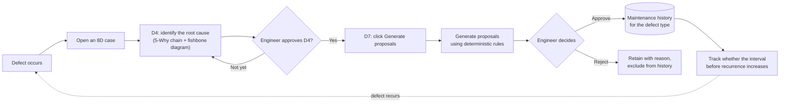
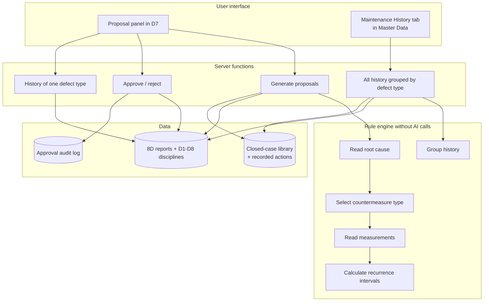
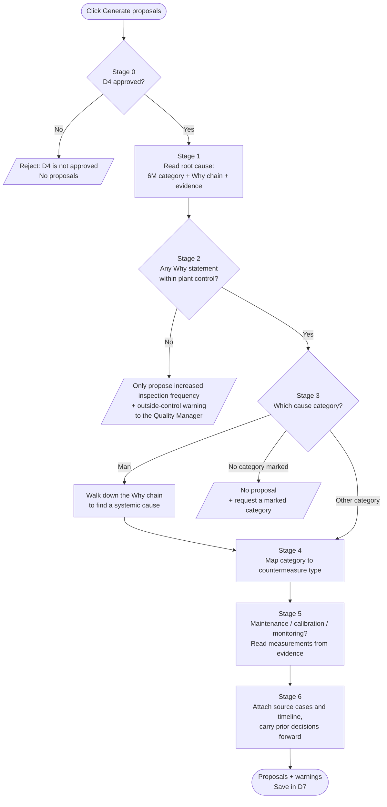
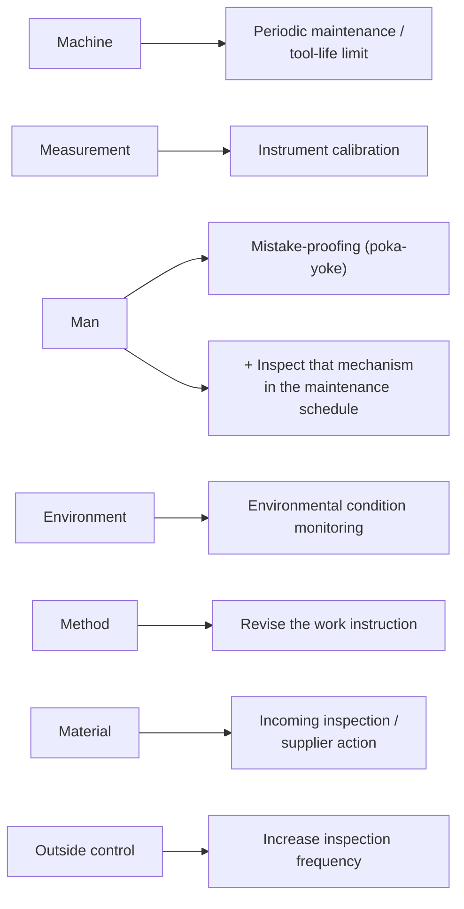
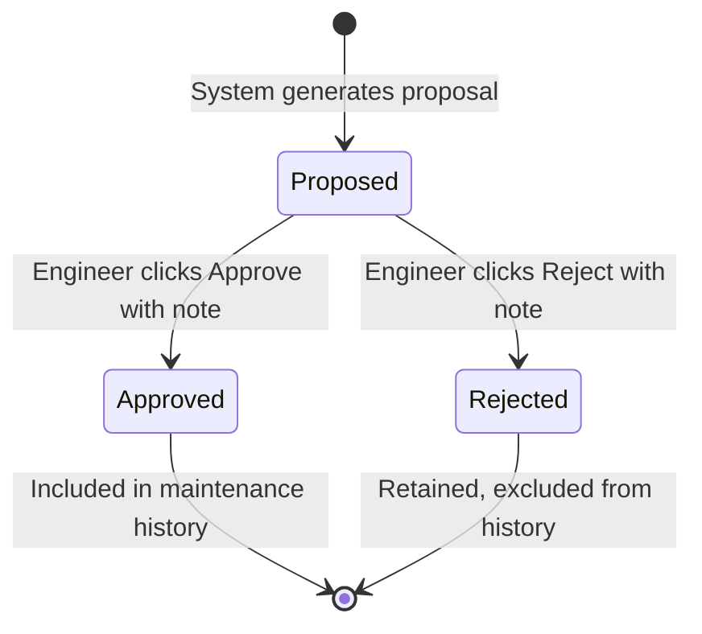
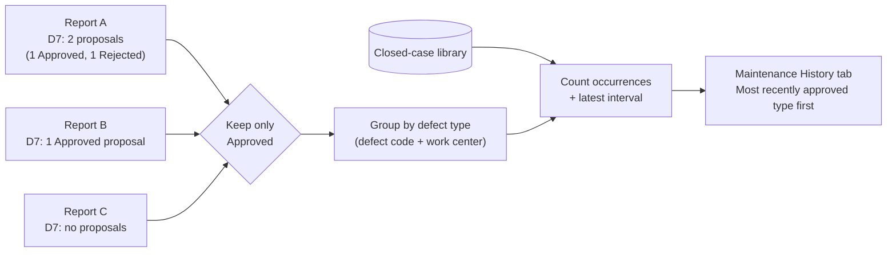
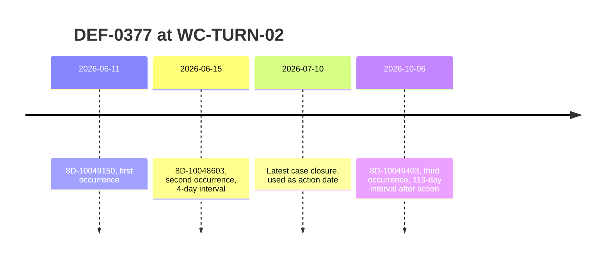

# Feature Briefing: Maintenance History & Preventive Maintenance Proposals

> **AI4Biz submission status:** This is preparation/reference material, not a confirmed final submission. Slides and presentation must be in English; PDF ≤15 slides, demo video ≤2 minutes, final pitch ≤15 minutes plus 5-minute Q&A, with at least 3 presenting members. Rehearsal material must be adapted to these limits before submission.

> **Competition context:** [AI4Biz 2026 - LIKELION Vietnam](https://app.notion.com/p/likelion/AI-FOR-BUSINESS-INNOVATION-3f744860a4f480ab920ddb3911a25c21), team UIT_4Lovpe. Competition requirements and submission limits are maintained in that reference; technical examples below are not measured business outcomes unless explicitly documented.

> **Audience:** Final-round presenters.
> **Purpose:** Explain the feature from first principles: the problem it addresses, data processing, decisions at each stage, capabilities, and limitations. This is background material rather than a speaking script, so presenters can answer questions in their own words.
> **Author:** Duy.
> **How to read:**
> - Each section begins with a plain-language explanation. The **📎 Code** references point to the implementation for inspection.
> - Diagrams use Mermaid and can be viewed on GitHub or in VS Code.
> - Implementation observations and line references describe `main` at commit `d4d10b0`. Examples and limitations are reference-revision observations, not a new verification run or a guarantee of current live behavior.

## Contents

1. The requested problem and the team's interpretation
2. Core idea
3. Overall flow
4. Input data: what the system reads and where
5. Proposal-generation pipeline, stage by stage
6. Proposal lifecycle: generation, approval, and history
7. How maintenance history is assembled
8. Measuring recurrence intervals
9. Four safeguards against invented information
10. Three data examples
11. Known limitations
12. Questions judges may ask
13. Glossary and code map

## 1. The Requested Problem and the Team's Interpretation

**Requested capability, paraphrased:** Maintain history for each defect type so the plant can perform maintenance proactively instead of waiting for a defect to occur. This is the project interpretation recorded for the reference implementation; current competition requirements remain in the official challenge reference above.

**Available project context:**

- The application follows the 8D process: incident, 8D case, root-cause investigation, correction, prevention, and closure. This starts as a **response to an incident**.
- It has **no** maintenance ledger, equipment inventory, or machine sensor feed.
- It **does** have an 8D case library containing root causes investigated and approved by engineers.

**The team's interpretation:**

Proactive action does not require predicting the future. Once a defect's cause is understood, **turn that knowledge into a recurring task intended to prevent recurrence**, then observe whether the defect returns.

## 2. Core Idea

Three points to remember:

1. **Input is approved knowledge.** The system uses a D4 root cause only after an engineer approves D4.
2. **Output is a proposal, decided by a person.** Engineers approve or reject proposed work. Only approved proposals count toward maintenance history.
3. **History grows and can be measured.** Processing more 8D cases adds records for each defect type. The measurement is the actual number of days between recurrences.

**Why does this feature not predict when a machine will fail?**

- There is no supporting data for such a prediction. Predicting without it would invent information.
- The product follows the principle of withholding unsupported conclusions. For example, internal test case 4 refuses a poorly related precedent and hands the question to a person; it is not an official AI4Biz score.
- The system already contains its most reliable input: an engineer-approved root cause.

📎 **Code:** Design rationale appears at the start of [rules.ts](../srv/src/domain/eightd/maintenance/rules.ts), lines 1-27 in the reference revision.

## 3. Overall Flow

### 3.1. From an incident to maintenance history



### 3.2. System components



📎 **Code:**

- UI: [maintenance-panel.tsx](../app/8D_hackathon_ui/src/pages/eight-d/maintenance-panel.tsx) and [MaintenanceHistoryTab.tsx](../app/8D_hackathon_ui/src/pages/master-data/MaintenanceHistoryTab.tsx).
- Four server functions in [EightDService.cds](../srv/EightDService.cds): `proposeMaintenancePlan`, `decideMaintenanceProposal`, `getMaintenanceHistory`, `listMaintenanceHistory`.
- Rules: [rules.ts](../srv/src/domain/eightd/maintenance/rules.ts).
- Persistence: [maintenanceStore.ts](../srv/src/domain/eightd/maintenance/maintenanceStore.ts).

## 4. Input Data: What the System Reads and Where

| Required information | Source | Notes |
| - | - | - |
| The incident's **defect type** | 8D report: defect code + work center | Same defect type means the same code **and** work center |
| Incident detection date | 8D report | Used for the timeline |
| Whether D4 is approved | D4 review status | If not approved, reject the request and stop |
| Root-cause category | D4 fishbone category marked as a cause | Priority: engineer-confirmed category, first marked row, category in the root-cause section, then category on the report |
| 5-Why chain | D4 | Read from shallowest to deepest |
| Numerical evidence | Descriptions and measurements of rows marked as causes | The only permitted source of numerical values |
| Earlier occurrences of the same defect type | **Closed** cases with the same defect code + work center, excluding the current incident | Includes detection date, closure date, and cause category |
| Previously implemented preventive measures | Preventive actions from those closed cases | Shown for the reviewer's reference |

📎 **Code:**

- Load the report with D4 and D7: `loadReport`, [maintenanceStore.ts](../srv/src/domain/eightd/maintenance/maintenanceStore.ts), line 64.
- Retrieve closed cases of the same type: `fetchDefectTypeHistory`, line 76 of the same file.
- Read the root cause in priority order: `normalizeRootCause`, [rules.ts](../srv/src/domain/eightd/maintenance/rules.ts), line 132.

## 5. Proposal-Generation Pipeline, Stage by Stage

Clicking **Generate proposals** runs six processing stages after the initial approval check. The entire pipeline **makes no AI calls**: identical input produces identical output.



### Stage 0: Check prerequisites

- If **D4 is not approved**, the system states that it only proposes measures from an approved root cause and stops.
- The button is also enabled only when **D7 is in progress and not approved**. Approved steps are locked under the application's general workflow and must be reopened before editing.

📎 **Code:** [rules.ts](../srv/src/domain/eightd/maintenance/rules.ts), line 406. Button conditions: [maintenance-panel.tsx](../app/8D_hackathon_ui/src/pages/eight-d/maintenance-panel.tsx), line 121.

### Stage 1: Read the root cause

The system collects three items from D4:

1. The engineer-selected **6M category**: Man, Machine, Method, Material, Measurement, or Environment.
2. The **Why chain**, ordered from shallowest to deepest.
3. **Evidence**: descriptions and measurements from rows marked as causes, for example *"tool operated for 41,200 of 30,000 strokes"*.

It supports both application-generated records and the sample-dataset record shape.

⚠️ **Reference implementation behavior:** When choosing the Why chain, it takes **the first array found, even if empty**. Some seeded records store an **empty** Why array in D4 while the actual chain remains in the original case, which the system never reaches. It therefore sees **zero Why statements** for those records. The consequences appear in Stage 2 and limitation 1 in Section 11. Cases whose D4 was reanalyzed by the application, such as 403 and 788, have the full chain.

📎 **Code:** `normalizeRootCause`, [rules.ts](../srv/src/domain/eightd/maintenance/rules.ts), line 132; line 137 selects the first array.

### Stage 2: Exclude causes outside plant control

- Examine each Why statement and exclude external causes such as natural disasters, floods, storms, lightning, grid outages, customer misuse, transport damage, or explicit "outside control" statements.
- ⚠️ **Reference implementation behavior:** This branch also catches a **Why chain that is empty from the start**. The displayed reason is *"The 5-Why chain is empty - there is no controllable cause to build on"*. Missing information and external causes therefore receive the same handling. This is limitation 1.
- If **no controllable statement remains**, the system does not invent a maintenance schedule. It makes one proposal, *"Increase inspection frequency for this defect type"*, without a numerical interval, and asks the **Quality Manager** to confirm whether the cause is truly outside plant control.

📎 **Code:** External-cause keywords: [rules.ts](../srv/src/domain/eightd/maintenance/rules.ts), line 81. Handling: lines 177-185 and 414-435.

### Stage 3: Follow the cause deeper

This is the central reasoning rule.

- **When the marked category is Man**, the system does not stop at blaming an operator. It reads the Why chain **from deepest to shallowest**, selecting the first statement that identifies a systemic cause through keywords:

| Keywords in the Why statement | Interpreted category |
| - | - |
| machine, tool, fixture, die, wear, tool life, strokes, cycles, maintenance plan, lubrication | Machine |
| gauge, calibration, measurement, sensor, measuring instrument, torque wrench | Measurement |
| procedure, instruction, document ID DOC-…, checklist, missing step | Method |
| supplier, raw material, incoming goods, material certificate | Material |
| temperature, humidity, dust, contamination, vibration | Environment |

If nothing matches, the category remains Man and the system proposes mistake-proofing (Stage 4).

⚠️ This deeper search requires a Why chain. Seeded Man-category cases such as `8D-10048880` have an empty chain in the reference revision and show "Increase inspection frequency" before reaching this stage. The automated test at line 63 covers the intended deeper-search behavior; the original briefing did not establish a UI demo case for it. Run the test before claiming a current pass.

- **For a category other than Man**, honor the engineer's selected category and use the **deepest Why statement** as the proposal basis.
- **If no category is marked**, do not guess. Ask the **Quality Engineer** to mark a fishbone category and regenerate.

**Why are causes not ranked first, second, and so on?** The data only records whether each category is or is not a cause. Ranking would add an unapproved judgment. Selecting a category the engineer rejected merely to produce a maintenance answer would misrepresent the evidence.

📎 **Code:** `classifyControl`, [rules.ts](../srv/src/domain/eightd/maintenance/rules.ts), line 176. Keyword map: line 72.

### Stage 4: Select the countermeasure type



- Maintenance is **one** possible countermeasure. A process cause calls for a process change; the system does not turn every cause into machine maintenance.
- The **Man** category produces **two** proposals: install mistake-proofing and add an inspection of that mechanism to the maintenance schedule. An undetected failed safeguard provides no protection. The second proposal is maintenance, so it also passes through Stage 5: obtain numbers from evidence, or leave the field blank and ask a person.
- The mapping uses **deterministic rules**. A wrong classification could look valid and be counted as such, so this classification is not delegated to AI.

📎 **Code:** Mapping: [rules.ts](../srv/src/domain/eightd/maintenance/rules.ts), lines 46-53. Display labels: line 58. Additional Man-category proposal: line 464.

### Stage 5: Extract measurements, intervals, and limits

Three countermeasure types require numbers: periodic maintenance, calibration, and environmental monitoring. Numbers must appear **in the evidence text itself**, using these patterns:

| Evidence pattern | Interpretation |
| - | - |
| "41,200 **of** 30,000 strokes" or "41,200 strokes **against** a 30,000 stroke limit" | Limit: 30,000 strokes; actual usage: 41,200 |
| "**every** 500 cycles" | Once every 500 cycles |
| "30,000 stroke **limit**" or "90-day **interval**" | A 30,000-stroke limit or a 90-day interval |

- Recognized units: strokes, cycles, shots, parts, hours, days, weeks, months, shifts.
- Commas are interpreted only as thousands separators, as in "41,200". A value such as "0,32 mm" must never be misread as 32.
- **If no number is found, leave the field blank** and ask the **Maintenance Engineer** to supply a measured value. The system does not invent an interval.
- The UI also shows the **original evidence excerpt** from which the value was extracted, allowing direct review.

📎 **Code:** Patterns: [rules.ts](../srv/src/domain/eightd/maintenance/rules.ts), line 238. `extractInterval`: line 257. Missing-value warning: lines 483-490.

### Stage 6: Attach provenance and timeline, and retain prior decisions

1. **Source cases:** Each proposal cites the current case and earlier cases with the same defect type **and cause category**. Earlier cases from other cause categories are excluded to avoid claiming support they do not provide.
2. **Timeline:** Collect detection dates and calculate intervals, as explained in Section 8.
3. **Earlier measures:** List preventive actions from earlier occurrences for the reviewer.
4. **Prior decisions:** Each proposal has a stable ID derived from countermeasure type and Why-step number. Regeneration preserves Approved or Rejected status when the ID matches.

The result is **saved immediately in the case's D7**. A rejection at Stage 0 saves nothing.

📎 **Code:**

- Source cases: [rules.ts](../srv/src/domain/eightd/maintenance/rules.ts), line 451.
- Retain decisions: `carryDecisions`, line 500.
- Save D7: [maintenance-panel.tsx](../app/8D_hackathon_ui/src/pages/eight-d/maintenance-panel.tsx), line 82.
- Complete pipeline: `buildMaintenancePlan`, [rules.ts](../srv/src/domain/eightd/maintenance/rules.ts), line 378.

## 6. Proposal Lifecycle

### 6.1. States



### 6.2. What happens on Approve

```mermaid
sequenceDiagram
    actor ENG as Engineer
    participant UI as D7 panel
    participant SV as Server
    participant D7 as Case D7
    participant LOG as Approval audit log
    ENG->>UI: Click Approve, note "Agreed"
    UI->>SV: Approve proposal X in case Y
    SV->>SV: Read reviewer identity from session<br/>Do not trust identity in request data
    SV->>D7: Set X to Approved<br/>Record reviewer, time, note
    SV->>LOG: Add maintenance-proposal approval entry<br/>with proposal snapshot
    Note over D7,LOG: Both writes share one transaction<br/>If either fails, both roll back
    SV-->>UI: Done
    UI-->>ENG: Proposal approved; refresh history
```

Three operational details:

- **The server determines reviewer identity** from the session, rather than accepting an identity submitted by the browser.
- **Every decision leaves an audit trail** containing the person, time, status transition, and proposal content at that moment. Its label, "Approved maintenance proposal …", distinguishes it from approval of the entire D7 step.
- **The state update and audit entry are atomic**: neither should persist without the other.

📎 **Code:**

- `decideMaintenanceProposal`: [maintenanceStore.ts](../srv/src/domain/eightd/maintenance/maintenanceStore.ts), line 122.
- Session identity: [eightDService.ts](../srv/src/services/eightDService.ts), line 699.
- State transition: `applyDecision`, [rules.ts](../srv/src/domain/eightd/maintenance/rules.ts), line 523.
- Audit labels: [audit-trail-panel.tsx](../app/8D_hackathon_ui/src/pages/eight-d/audit-trail-panel.tsx).

## 7. How Maintenance History Is Assembled

### 7.1. A derived view rather than a separate history table

Maintenance history is a **computed view** of all **approved** proposals stored in D7 across reports, grouped by defect type.

Benefits:

- **One source of truth**, without duplicate records to reconcile.
- **No additional database structure** for a separate history store.
- **History grows through use**: another approved proposal adds another entry.



### 7.2. Two places to view history

1. **A case's D7 panel:** Approved history for **that exact defect type**, newest first.
2. **Maintenance History in Master Data:** **All** defect types with at least one approved proposal.
   - Each row shows defect type, work center, countermeasure type, occurrence count, and latest interval.
   - Open a row to inspect each proposal: task, interval, reviewer, and source case.
   - Filter by work center and countermeasure type.
   - This tab is read-only; approvals happen in D7.

Occurrence counting combines reports and the closed-case library, **deduplicating by incident ID** so a case present in both is counted once. With fewer than two occurrences, the interval is blank ("Not enough data"), **never zero**.

📎 **Code:**

- Filter approved proposals: `approvedProposalsOf`, [rules.ts](../srv/src/domain/eightd/maintenance/rules.ts), line 558.
- Group and count: `groupMaintenanceHistory`, line 606.
- Data access: `getMaintenanceHistory` at line 172 and `listMaintenanceHistory` at line 182 in [maintenanceStore.ts](../srv/src/domain/eightd/maintenance/maintenanceStore.ts).
- Tab UI: [MaintenanceHistoryTab.tsx](../app/8D_hackathon_ui/src/pages/master-data/MaintenanceHistoryTab.tsx).

## 8. Measuring Recurrence Intervals

The intended outcome is a longer interval before the same defect recurs. The system measures that interval.

**Calculation:**

1. Collect detection dates for the same defect type: earlier closed occurrences and the current one. Remove duplicate dates and sort chronologically.
2. **Action date** is the latest closure date among earlier cases before the current occurrence. This is the calculation's proxy for application of the measure, not independently recorded maintenance-execution evidence.
3. Compute days between consecutive occurrences. Label an interval **After action** if it **ends after** that date; otherwise label it **Before action**.

**Seed-data example: DEF-0377 at WC-TURN-02** (undersized turned shaft). The reference calculation uses these dates:



The before-action interval is **4 days** and the after-action interval is **113 days**. All three cases have the **Method** cause category, so all three can appear as source cases.

**Limits of this illustration:**

- The referenced sample contains 35 incidents across 25 defect types; most types occur only once or twice. DEF-0377 has three occurrences because it includes demo case 403.
- The pair **4 → 113 days** illustrates the measurement but **does not establish statistical effectiveness** or causation.
- Statistical conclusions require more observations.
- These values come from seed data; the original briefing explicitly did **not** verify this example through the live UI. No new live verification is claimed here.

📎 **Code:** `recurrenceIntervals`, [rules.ts](../srv/src/domain/eightd/maintenance/rules.ts), line 298. Selection of the action date: line 388.

## 9. Four Safeguards Against Invented Information

Maintenance reuses the application's common stop-and-ask mechanism. Its warnings **do not block subsequent work**; they explain who must supply which information. The D4 approval prerequisite is a separate hard rejection.

| Situation | System behavior | Responsible person |
| - | - | - |
| D4 not approved | Reject the request; generate no proposal | Explain the prerequisite |
| No controllable Why statement | Propose increased inspection frequency only | Quality Manager |
| No cause category marked | Generate no proposal | Quality Engineer |
| A number is needed but absent from evidence | Propose the task with a blank interval | Maintenance Engineer |
| ⚠️ Empty Why chain (reference behavior, limitation 1) | Handled like the no-controllable-cause case: increased inspection frequency only | Quality Manager |

📎 **Code:** Warning creation: `planStop`, [rules.ts](../srv/src/domain/eightd/maintenance/rules.ts), line 374. Shared stop mechanism: [stops.ts](../srv/src/domain/eightd/stops.ts).

## 10. Three Data Examples

These describe the reference revision and its sample data. They preserve the distinction between intended behavior, code-level observations, and live UI verification; they are not current test results.

### Example A: 8D-10049403, an undersized turned shaft

This is the reference case for demonstrating the method-based path, subject to checking its current state before presenting.

- **Approved cause:** Method. Work instruction DOC-4410 lacks a tool-offset reset step after replacement. Spindle runout of 0.004 mm remains within specification, so the machine is not identified as faulty.
- **Reference code-level result on seed data:**
  - One proposal: *"Revise the work instruction - addresses: DOC-4410 has no offset reset step and the controller does not prompt for one."* It is based on Why step 3 and does **not** propose machine maintenance.
  - Interval: not applicable, because revising an instruction requires no numerical interval. No warning is expected for that reason.
  - Source cases: **8D-10049403, 8D-10048603, 8D-10049150**, all with the same defect type and Method category.
  - Timeline: three occurrences, with **4 days before** and **113 days after** the action-date proxy (Section 8).
- **Meaning:** A process cause leads to a process correction.
- The reference case's D7 was in progress and therefore eligible for generation and approval. The original example was evaluated in code and **not through the live UI**; inspect the current state before demonstrating it.

### Example B: 8D-10048788, rotor-shaft waviness at WC-GRIND-04

- **Approved cause:** Machine, specifically an unbalanced grinding-wheel assembly in Why step 3.
- **Reference behavior:** The original local-server and seed-data observations agreed on:
  - One *periodic maintenance* proposal based on Why step 3, with a **blank interval**.
  - A yellow warning asking the **Maintenance Engineer** for a measured value because the case records no interval or limit.
  - One occurrence, so no recurrence interval.
- **Meaning:** The system does not invent a convenient "every 30 days" schedule.

### Example C: 8D-10048420, a bore-mouth burr at WC-BROACH-01

This example explains the intended rule and its known input limitation.

- **Data:** The broaching tool has run **41,200 strokes** against a **30,000-stroke** replacement limit. The deepest Why statement says tool life was recorded manually on paper with no assigned owner.
- **Intended result with a complete Why chain:** Periodic maintenance with a 30,000-stroke limit extracted from "41,200 of 30,000 strokes". The first automated test covers this complete-input scenario; a current pass must be verified by running it.
- ⚠️ **Reference behavior on the seeded case:** *"Increase inspection frequency…"* plus an outside-control warning for the Quality Manager, because D4 contains an empty Why chain (limitation 1). D7 is also already approved in that reference record, so the button is locked.
- Explain the limitation openly if this record is inspected. It cannot demonstrate the intended complete-input path in that state.

### A further distinction in the data

A defect can recur **with a different cause**. For DEF-0512 at WC-CAST-03, one occurrence is attributed to Material and another to Machine. This illustrates that later recurrence may involve a different cause; it does not by itself prove that the previous measure was effective. Because source-case citations require the **same cause category**, the system does not present the two causes as equivalent support.

📎 **Code:** Scenario coverage is in [maintenance.test.ts](../srv/src/domain/eightd/__tests__/maintenance.test.ts), including the broaching example at line 51 and the Man-category example at line 63 of the reference revision. Test counts and historical PASS totals are not evidence of a current pass; run the relevant tests for the revision being demonstrated.

## 11. Known Limitations

The following limitations belong to the reference revision. Check whether they still apply before presenting the current build.

1. **Some seeded cases are misclassified as outside plant control.**
   - The original case contains the Why chain, but D4's Why field is empty. The system reads D4 first, treats the empty chain as having no controllable statement, and recommends increased inspection frequency with an outside-control warning.
   - Correct interpretation: *"Missing information; a person must supply the Why chain."*
   - Reference examples affected include `8D-10048420`, `8D-10049010`, `8D-10048880`, and `8D-10049060`. Reanalyzed cases `8D-10049403` and `8D-10048788` have complete D4 chains.
   - Even with the wrong classification, it **does not invent a maintenance schedule** and still sends the question to the Quality Manager.
   - The missing distinction is between absent evidence and an external cause; an empty D4 chain also prevents use of the chain in the original case.
   - 📎 `normalizeRootCause` at line 132 and the start of `classifyControl` at lines 177-185 in [rules.ts](../srv/src/domain/eightd/maintenance/rules.ts).
2. **Generation and approval require D7 to be in progress.** Reopen an approved D7 before editing. This is the application's workflow rule.
3. **No automatic owner assignment.** The field displays "Unassigned". An assignment mechanism would need an explicit choice, for example from the D1 team as corrective actions use in D5; that behavior is not provided by this reference feature.
4. **Regenerate can change approved history.**
   - A matching proposal ID retains its approved status, but its wording is replaced by the regenerated content.
   - If the ID changes, for example after a D4 cause or Why-step change, the previous approved proposal **disappears from D7 and history**.
   - Avoid regeneration after approval when the approved record must be retained.
   - 📎 `carryDecisions`, [rules.ts](../srv/src/domain/eightd/maintenance/rules.ts), line 500.
5. **The referenced live demo resets newly created data on server restart.** Reviewers may appear as "anonymous" because login is not required in that demo. Demonstrating history therefore requires an approved proposal in the current session; verify the deployment's present persistence and authentication behavior.

## 12. Questions Judges May Ask

**Concept questions**

**Q1. Why not use AI to predict machine failure?**

The reference feature has neither sensor history nor a maintenance ledger to support that prediction. It therefore uses approved root causes and does not claim predictive-maintenance capability.

**Q2. Is this proactive if an incident must happen first?**

The first incident supplies the lesson. Afterward, the lesson becomes a recurring task, such as replacing a tool before 30,000 strokes, intended to prevent later occurrences. Recurrence intervals provide a way to observe the outcome.

**Q3. How is this different from ordinary D7?**

Ordinary D7 addresses one case. This feature groups approved proposals across cases of the same defect type, keeps an audit trail, and tracks intervals over time.

**Reliability questions**

**Q4. Does AI participate, and can it invent details?**

Maintenance proposal generation **does not call AI**. Deterministic rules select categories, measurements, and source cases. AI may participate earlier in root-cause analysis, whose result must be approved by an engineer. Rule-based generation still has the documented input and classification limitations.

**Q5. What if the approved root cause is wrong?**

Each proposal identifies its source case and Why step, so a correction can be traced to affected proposals. In the reference example, case 403 changed from Machine to Method after reanalysis. Regeneration still has the history-retention limitation described in Section 11.

**Q6. Where does the interval come from? Is it invented?**

Only from numerical evidence in the source text, with the original excerpt displayed for review. If no number is available, the field stays blank and a Maintenance Engineer is asked to supply it.

**Q7. How can 35 incidents prove effectiveness?**

They cannot establish a statistical conclusion, and no such claim is made. The measurement mechanism is available and more observations are needed over time.

**Difficult-case questions**

**Q8. How are human causes handled? Is the answer simply retraining?**

The system follows the Why chain for an underlying systemic cause. If Man remains the category, it proposes mistake-proofing plus maintenance inspection of that mechanism.

*The automated test covers this rule, but seeded Man-category cases in the reference revision have the empty-chain limitation and show increased inspection frequency. Explain limitation 1 if those records are opened; do not present the intended path as an observed UI result.*

**Q9. What about grid outages or natural disasters?**

The system does not invent maintenance. It recommends increased inspection frequency for earlier detection and refers the decision to the Quality Manager.

**Q10. What if one defect type has several causes? Why not rank them?**

The source only marks whether each category is a cause. A ranking would add an unapproved judgment, so the system follows the engineer's selected category.

**Operational questions**

**Q11. Who is responsible for carrying out a proposal?**

The reference feature does not automatically assign an owner. This remains an operational gap; selecting from the D1 team would require additional supported behavior.

**Q12. Why is maintenance history not a separate table?**

It is derived from approved proposals, retaining one source of truth. An SAP integration could use that list as input to maintenance planning, but such integration is not claimed here.

**Q13. Can anyone approve? Is there control?**

Reviewer identity is taken from the server-side session and every decision is audited. The demo does not require login and can show "anonymous". This must not be presented as production access control; a production deployment needs authenticated plant accounts.

## 13. Glossary and Code Map

### Glossary

| Term | Meaning |
| - | - |
| 8D | Eight-discipline process for resolving quality incidents |
| Root cause | The underlying cause whose correction is intended to prevent recurrence |
| 5-Why | Repeatedly asking why to reach an underlying cause |
| Fishbone / 6M | Six cause categories: Man, Machine, Method, Material, Measurement, Environment |
| Defect type | The same defect code at the same work center |
| Work center | Machine or production area where a defect occurs |
| Preventive maintenance | Scheduled or usage-based maintenance before failure |
| Poka-yoke | A mechanism designed to prevent an incorrect operation |
| Approval audit log | Record of who approved what and when |
| Recurrence interval | Days between occurrences of the same defect type |

### Code map

Line numbers refer to commit `d4d10b0` and may move in later revisions.

| Component | File | Main locations |
| - | - | - |
| Core rules | [rules.ts](../srv/src/domain/eightd/maintenance/rules.ts) | Mapping 46; keywords 72-81; root-cause normalization 132; classification 176; number extraction 257; intervals 298; pipeline 378; decision retention 500; approval 523; history grouping 606 |
| Persistence | [maintenanceStore.ts](../srv/src/domain/eightd/maintenance/maintenanceStore.ts) | Generate 102; approve 122; one-type history 172; all history 182 |
| Service contract | [EightDService.cds](../srv/EightDService.cds) · [eightDService.ts](../srv/src/services/eightDService.ts) | Request handling from line 689 |
| D7 writable fields | [eightDRepository.ts](../srv/src/domain/eightd/eightDRepository.ts) | D7 field allowlist at line 634 |
| D7 panel | [maintenance-panel.tsx](../app/8D_hackathon_ui/src/pages/eight-d/maintenance-panel.tsx) | Generate 82; approve 99; button conditions 121 |
| Master Data tab | [MaintenanceHistoryTab.tsx](../app/8D_hackathon_ui/src/pages/master-data/MaintenanceHistoryTab.tsx) · [index.tsx](../app/8D_hackathon_ui/src/pages/master-data/index.tsx) | History list and tab integration |
| Tests | [maintenance.test.ts](../srv/src/domain/eightd/__tests__/maintenance.test.ts) | Scenario coverage; run for current results |
